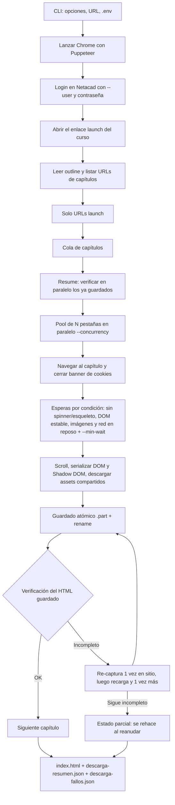

# ccna-dl — Documentación completa

> Descargador de cursos de [Cisco Networking Academy (Netacad)](https://www.netacad.com/) a **HTML sin conexión**, con descarga en paralelo, esperas por condición y validación offline.
> Rama de trabajo: `optimizacion` · Versión del paquete: `1.4.0` · Basado en [garzj/ccna-dl](https://github.com/garzj/ccna-dl).

## Índice

1. [Qué es y para qué sirve](#1-qué-es-y-para-qué-sirve)
2. [Requisitos e instalación](#2-requisitos-e-instalación)
3. [Configuración (`.env`)](#3-configuración-env)
4. [Cómo obtener el enlace del curso](#4-cómo-obtener-el-enlace-del-curso)
5. [Uso paso a paso](#5-uso-paso-a-paso)
6. [Estructura de la carpeta de salida](#6-estructura-de-la-carpeta-de-salida)
7. [Cómo funciona por dentro](#7-cómo-funciona-por-dentro) (7.5: vídeos y subtemas falsos)
8. [Validación](#8-validación)
9. [Pruebas](#9-pruebas)
10. [Resultados: prueba real y benchmark](#10-resultados-prueba-real-y-benchmark)
11. [Solución de problemas](#11-solución-de-problemas)
12. [Limitaciones conocidas y riesgos](#12-limitaciones-conocidas-y-riesgos)
13. [Estado de las descargas existentes y changelog](#13-estado-de-las-descargas-existentes-y-changelog)
14. [Uso en Termux (Android)](#14-uso-en-termux-android)

---

## 1. Qué es y para qué sirve

`ccna-dl` abre Netacad con un navegador automatizado (Puppeteer + Chrome), inicia sesión con **tu propia cuenta**, recorre el índice (outline) de un curso y guarda **cada capítulo como un archivo HTML autónomo** junto con sus recursos (CSS, fuentes, imágenes, archivos). El resultado se puede abrir sin internet.

- **Uso previsto:** personal y educativo, con tu propia cuenta de Netacad y para cursos en los que estás matriculado. No lo uses para redistribuir material (ver el *Disclaimer* del [README](README.md)).
- Los cursos nuevos de Netacad ("launch") se guardan como **HTML offline**. Solo se admiten enlaces de tipo launch: el modo PDF de la interfaz clásica se quitó (esa interfaz ya no existe).
- Lo que **no** garantiza: los vídeos (ver [§12](#12-limitaciones-conocidas-y-riesgos)).

## 2. Requisitos e instalación

| Requisito | Detalle |
|---|---|
| Node.js | Se ha usado Node 22 en el PC y Node 20 en las pruebas; el validador necesita Node ≥ 16. |
| Google Chrome | Puppeteer 22 usa su propio Chrome (carpeta de caché de Puppeteer, `~/.cache/puppeteer`). Si prefieres un Chrome ya instalado, ver nota. |
| Cuenta de Netacad | Con acceso al curso. |

**Instalación (PowerShell, desde la carpeta del proyecto):**

```powershell
cd C:\Users\alexs\OneDrive\Documentos\Learn\Node\ccna-dl
npm install
npm run build        # compila src/ → lib/ (rimraf lib/ && tsc)
node lib/cli.js --help
```

> **Nota sobre Chrome / `CHROME_PATH`.** El programa (`src/cli.ts`) **no lee** `CHROME_PATH`: lanza el Chrome que descarga Puppeteer. Si quisieras usar otro Chrome, la variable que entiende Puppeteer es `PUPPETEER_EXECUTABLE_PATH`.
> `CHROME_PATH` (o `PUPPETEER_EXECUTABLE_PATH`) sí lo leen las **pruebas** y el benchmark (`test/*.js`):
> ```powershell
> $env:CHROME_PATH = 'C:\Program Files\Google\Chrome\Application\chrome.exe'
> npm test
> ```

También se puede ejecutar con `npx ccna-dl …` o `npm start -- <args>` (equivale a `node ./lib/cli.js`). Tras cambiar código en `src/` hay que repetir `npm run build`.

## 3. Configuración (`.env`)

El programa carga un archivo `.env` de la carpeta desde donde se ejecuta (`dotenv`). **Nunca subas ese archivo a git** (ya está en `.gitignore`) ni lo compartas.

Variables que el código lee (solo nombres, **sin valores**):

| Variable | Para qué sirve |
|---|---|
| `PASSWORD` | Contraseña de Netacad. Si no existe ni se pasa `--password`, el programa te la pregunta por consola (entrada oculta). |
| `NODE_ENV` | Opcional. Si no está definida se usa `production`. |

El correo/usuario **no** va en el `.env`: se pasa siempre con `--user` / `-u`.

Orden para la contraseña: `--password` → variable `PASSWORD` (`.env`) → pregunta interactiva.
Recomendación: usa `.env` o la pregunta interactiva; evita `--password` porque queda en el historial de PowerShell.

## 4. Cómo obtener el enlace del curso

El programa necesita el **enlace "launch" del contenido del curso**, no la URL de la barra de direcciones. Tiene esta forma:

```
https://www.netacad.com/es/launch?id=<id-del-curso>&tab=curriculum&view=<id-de-vista>
```

Pasos (según el [README](README.md)):

1. Entra en [netacad.com](https://www.netacad.com) e inicia sesión.
2. Abre tu curso (la opción de lanzar/abrir el curso).
3. Copia **el enlace que lleva al contenido del curso** (clic derecho sobre el botón/enlace → *Copiar dirección del enlace*), no el de la barra de direcciones. Hay una imagen de ejemplo en [`img/copy-link-example.png`](img/copy-link-example.png).
4. Pégalo **entre comillas** en PowerShell (la URL lleva `&`):

```powershell
node lib/cli.js --user tu@correo.com "https://www.netacad.com/es/launch?id=<id>&tab=curriculum&view=<id>"
```

El `id=` de la URL se usa como identificador del curso para nombrar la carpeta de salida. Se pueden pasar **varias URLs** a la vez (se procesan una tras otra).

> El contenido real se pinta dentro de un iframe de `www.netacad.com/authoring-resources/…`; el programa lo localiza solo. Pásale siempre el enlace launch, no la dirección del iframe.

## 5. Uso paso a paso

Sintaxis: `node lib/cli.js [opciones] <url> [<url2> …]` (todos los ejemplos usan PowerShell; sustituye `$URL` por tu enlace).

```powershell
$URL = "https://www.netacad.com/es/launch?id=<id>&tab=curriculum&view=<id>"
```

### 5.1 Tabla de opciones (extraída de `src/cli.ts`)

| Opción | Por defecto | Qué hace |
|---|---|---|
| `<urls…>` | — | URL(s) de los cursos (obligatoria al menos una, salvo con `--validate`). |
| `--user`, `-u` | — | Correo/usuario de Netacad (obligatorio salvo con `--validate`). |
| `--password`, `-p` | `.env` → pregunta | Contraseña. |
| `--concurrency`, `-c N` | **2** automático (baja a 1 con poca RAM libre; máx. **6**) | Capítulos descargados a la vez (pestañas del navegador en paralelo). Cada pestaña puede usar ~1 GB; con un valor explícito se respeta pero se avisa si no cabe en la RAM libre. |
| `--recycle-every N` | **8** (`0` = nunca; **3** en Termux) | Cada `N` capítulos se vacía y se cierra/reabre la pestaña de cada worker para liberar la memoria del renderer de Chrome. También se recicla antes si el heap de JS de la pestaña supera ~600 MB o la RAM libre baja de ~700 MB. La pestaña de la sesión no se cierra: se cambia de proceso (`chrome://version` → `about:blank`). |
| `--no-videos` | desactivado | No activa los reproductores ni descarga vídeos (se queda el póster, como antes de la v. 3 del formato). Esos capítulos se guardan con formato 2 y la reanudación no los rehace por vídeos pendientes. |
| `--no-animations` | desactivado | No pulsa «play» en las animaciones interactivas (`<adobe-animate-view>`) ni las graba (§7.6). Sin esta opción cada animación se graba como `.webm` local (hasta 90 s por animación). |
| `--debug-network` | desactivado | Depuración (§7.6): escribe `<curso>/debug/red-<capítulo>.json` con los componentes de animación detectados y las peticiones de red de la activación, **sin cookies, cabeceras ni valores de query** (solo nombres de parámetros; los tramos de ruta que parecen tokens salen como `<token>`). |
| `--out-dir`, `-o` | `.` (carpeta actual) | Carpeta donde se crea la carpeta del curso. |
| `--only <expr>` | — | Descarga solo una parte del curso **sin sincronizar el curso entero** (§5.5). Acepta un capítulo (`--only 2.3`), un módulo entero (`--only 2`, incluye 2.0, 2.1…), una lista (`--only 2.1,2.3,5`) y rangos (`--only 2.1-2.4`, `--only 2-4`). |
| `--refresh-outline` | desactivado | Con `--only`: ignora `outline-cache.json` y vuelve a leer el outline (§5.5). |
| `--force` | desactivado | Vuelve a descargar todo aunque ya esté guardado y verificado. |
| `--retry-failed` | desactivado | Descarga solo los capítulos de `descarga-fallos.json`. |
| `--min-wait ms` | **1500** (500 con `--fast`) | Tiempo mínimo que el contenido debe llevar cargado antes de guardar, *además* de las esperas por condición. |
| `--chapter-timeout s` | **300** | Segundos máximos por intento de capítulo; al agotarse se reinicia esa pestaña y se reintenta. |
| `--fast` | desactivado | Modo rápido (opt-in, menos seguro): esperas más cortas y bloquea también `adobedtm` (el vídeo/audio también se bloquea con `--no-videos`). |
| `--no-block-trackers` | bloqueo activo | No bloquear analítica/publicidad/seguimiento. |
| `--asset-concurrency N` | **6** (**3** en Termux) | Descargas simultáneas de recursos por capítulo. |
| `--retries N` | **3** | Reintentos con espera creciente (recursos y capítulos fallidos; los reintentos de capítulo se limitan a 2 extra). |
| `--debug-screenshot` | desactivado | Depuración: guarda `<curso>/debug/course.png` (vista del curso tras el login). |
| `--debug-headful` | desactivado | Depuración: abre Chrome con ventana visible (headless por defecto). No disponible en Termux. |
| `--browser-path RUTA` | auto | Ejecutable de Chrome/Chromium (también `PUPPETEER_EXECUTABLE_PATH`). En Termux se usa `$PREFIX/bin/chromium-browser`. |
| `--verbose`, `-v N` | **2** | Verbosidad `1`-`3`. **1**: barras, avisos (`⚠`), errores (`✖`), capítulos parciales/fallidos y resumen final. **2**: además, el logo, los pasos principales (alumno, curso, capítulos encontrados) y una línea por capítulo guardado. **3**: además, login paso a paso, URLs, capítulos omitidos o que se rehacen y por qué, reintentos, reciclado/reinicio de pestañas y (sin terminal) una línea `[memoria]` cada 30 s. Los avisos y errores se ven siempre; las opciones `--debug-*` funcionan igual en cualquier nivel. |
| `--no-banner` | desactivado | No imprime el logo ASCII (con `-v 1` tampoco se imprime). |
| `--no-color` | desactivado | Sin colores ANSI. Los colores también se apagan con `NO_COLOR=1`, `TERM=dumb` o si la salida no es una terminal; `FORCE_COLOR=1` los fuerza. |
| `--no-progress` | desactivado | Sin barras ni spinners: solo líneas (es automático si la salida no es una terminal). |
| `--validate` | desactivado | Valida **offline** las descargas de `--out-dir` y escribe `validation-report.md`. No descarga ni inicia sesión. |
| `--help`, `-h` | — | Ayuda. |

**Opciones renombradas o quitadas** (si se usan, el programa termina con un error que indica la nueva):

| Antes | Ahora |
|---|---|
| `--dump-network` | `--debug-network` (salida en `<curso>/debug/red-<cap>.json`) |
| `--screenshot` | `--debug-screenshot` (salida en `<curso>/debug/course.png`) |
| `--headful` | `--debug-headful` |
| `--block-media` | quitada: `--no-videos` ya bloquea vídeo/audio |
| `--format`, `--timeout`/`-t` | quitadas (modo PDF de la interfaz clásica, que ya no existe; usa `--chapter-timeout`) |

### 5.2 Ejemplos

**Curso completo (recomendado; 2 pestañas, el valor por defecto):**

```powershell
node lib/cli.js --user tu@correo.com --concurrency 2 $URL
```

**Guardar en otra carpeta:**

```powershell
node lib/cli.js -u tu@correo.com -o D:\NetacadCursos $URL
```

**Probar un solo capítulo en una carpeta aparte (no toca tus cursos):**

```powershell
node lib/cli.js -u tu@correo.com --only 1.0 --concurrency 1 --out-dir C:\Users\alexs\ccna-test-1.0 $URL
```

**Reanudar después de un corte o Ctrl+C:** vuelve a lanzar **exactamente el mismo comando**. Los capítulos ya guardados y verificados se omiten (verificación en paralelo); se rehacen los que falten, estén dañados, estén marcados como incompletos o tengan un formato antiguo.

```powershell
node lib/cli.js -u tu@correo.com --concurrency 3 $URL
```

**Rehacer todo desde cero:**

```powershell
node lib/cli.js -u tu@correo.com --force $URL
```

**Reintentar solo lo que falló en la última ejecución** (lee `descarga-fallos.json`):

```powershell
node lib/cli.js -u tu@correo.com --retry-failed $URL
```

**Ajustar las esperas** (conexión lenta → más seguro; Netacad rápido y probado → más rápido):

```powershell
node lib/cli.js -u tu@correo.com --min-wait 2500 --chapter-timeout 420 $URL   # conservador
node lib/cli.js -u tu@correo.com --fast --concurrency 3 $URL                  # opt-in, menos seguro
```

**Ver el navegador / depurar:**

```powershell
node lib/cli.js -u tu@correo.com --debug-headful --debug-screenshot --only 1.0 -o C:\Users\alexs\ccna-test-1.0 $URL
```

**Otras opciones:**

```powershell
node lib/cli.js -u tu@correo.com --no-block-trackers $URL                     # no bloquear analítica
node lib/cli.js -u tu@correo.com --asset-concurrency 4 --retries 5 $URL       # recursos más suaves / más reintentos
```

### 5.5 `--only`: descargar solo parte del curso

```powershell
node lib/cli.js -u tu@correo.com --only 2 --force $URL          # módulo 2 entero (2.0, 2.1, 2.2…)
node lib/cli.js -u tu@correo.com --only 2.1,2.3 $URL            # dos capítulos
node lib/cli.js -u tu@correo.com --only 2.1-2.4 $URL            # rango
```

Una sola ejecución (un solo login) basta para varios capítulos o módulos: no hace falta un bucle de PowerShell con un `--only` por capítulo.

- **Escaneo reducido:** solo se expanden y leen los módulos implicados; los view ID se resuelven únicamente para los capítulos pedidos (no se recorre el sidebar entero ni se hacen las pasadas de reserva salvo que falte alguno). Un capítulo pedido que no existe se avisa (`⚠`) y se continúa con los demás.
- **Caché del outline:** tras leer el outline se guarda `<curso>/outline-cache.json` (solo capítulo → view ID, con fecha; sin credenciales ni cookies). Si una ejecución posterior con `--only` pide algo que la caché ya tiene (módulos leídos enteros o capítulos explícitos conocidos, con menos de 30 días), **no se escanea el outline**. `--refresh-outline` la ignora y la rehace; si un capítulo falla con "no se pudo abrir", úsalo (los view ID podrían haber cambiado). Aun con caché hay login y apertura del curso.
- **No se toca el resto del curso:** `index.html` y `descarga-resumen.json` se **mezclan** con lo existente (solo cambian las entradas tocadas; los demás capítulos no pasan a faltantes ni fallidos; el resumen lleva `"partial": true`). No se borra ningún capítulo.
- **Qué se rehace:** `--only` + `--force` rehace solo lo pedido. Sin `--force` se aplica la regla normal de reanudación: se omite lo ya verificado (un capítulo de formato 3 con vídeos pendientes se rehace) y se conserva su resultado anterior en el resumen.
- Una expresión inválida (`--only x`, `4-2`) termina con código 2 antes de abrir el navegador.

### 5.3 Qué verás en consola

- El **logo** `ccna-dl` en ASCII (colores cian/azul/magenta; solo caracteres ASCII, se ve bien en PowerShell y cmd).
- Mensajes de login, título del curso y número de capítulos encontrados (el detalle depende de `-v`).
- La **pantalla de carga** (cli-progress `MultiBar`, refresco cada 125 ms):
  - barra total con capítulos hechos, %, tiempo transcurrido y ETA;
  - **indicador de memoria** (`src/ui/resource-monitor.ts`): RSS de Node + suma de memoria del árbol de procesos del Chrome lanzado por puppeteer (a partir de `browser.process().pid`), RAM libre y pico. En Windows lo mide **un solo** PowerShell en segundo plano con `Get-CimInstance Win32_Process` (no usa `wmic`, que ya no viene en Windows 11) cada 2 s; en Linux/macOS, `ps`. En Windows es *working set*, que cuenta dos veces la memoria compartida entre procesos de Chrome, así que es una cota alta. Amarillo con < 1,5 GB libres, rojo con < 700 MB;
  - **una barra con spinner por pestaña**: capítulo en curso, fase (`abriendo` → `esperando contenido` → `vídeos` → `animaciones` → `recursos (N)` → `escribiendo HTML`; también `reintento N` y `2ª captura`) y segundos que lleva.
  - Mientras hay barras, cualquier `console.log` se escribe por encima de ellas sin romperlas.
  - En la consola clásica de Windows el spinner es `| / - \`; en Windows Terminal, VS Code, Linux y macOS usa caracteres braille.
- Una línea por capítulo con su resultado y tiempo, coloreada (verde `✔`, amarillo `⚠`, rojo `✖`), por ejemplo `[1/1] 1.0 · ✔ guardado con avisos (49 recursos, 18s)`.
- Al terminar, la memoria pico (Node + Chrome).
- Sin terminal (redirección a archivo, CI) o con `--no-progress`: sin barras ni colores, solo líneas.
- Al final, un **resumen**: capítulos guardados / omitidos / parciales / fallidos, duración total y, con paralelismo, la ganancia estimada (`ganancia ×N`).

### 5.4 Ctrl+C

- **Primera vez:** no se empiezan capítulos nuevos; los que están en curso terminan de escribirse (escritura atómica `.part` + `rename`), se guardan el índice y el resumen y se sale con código 130.
- **Segunda vez:** sale inmediatamente.
- Para continuar, repite el mismo comando.

## 6. Estructura de la carpeta de salida

Dentro de `--out-dir` se crea una carpeta por curso, llamada `<id-del-curso>_<título saneado>`:

```
<out-dir>/
└── <id>_<Título del curso>/
    ├── index.html                 # índice con enlaces a los capítulos
    ├── chapters/
    │   ├── 1.0.html               # un HTML autónomo por capítulo
    │   ├── 1.1.html
    │   └── …
    ├── assets/
    │   ├── css/                   # hojas de estilo
    │   ├── fonts/                 # fuentes
    │   ├── img/                   # imágenes
    │   ├── video/                 # vídeos (.mp4) y pósters
    │   └── files/                 # otros archivos (PDF, ZIP, …)
    ├── descarga-resumen.json      # resultado de la última ejecución (con --only se mezcla con el anterior)
    ├── outline-cache.json         # capítulo → view ID (caché para --only)
    └── descarga-fallos.json       # capítulos pendientes de reintentar
```

- Los recursos se guardan una sola vez y se referencian desde los capítulos como `../assets/<categoría>/<hash>_<nombre>`.
- `descarga-resumen.json`: `courseId`, `courseTitle`, `courseUrl`, `startedAt`, `finishedAt`, `durationMs`, `totals` (`total`, `guardado`, `omitido`, `parcial`, `fallido`) y, por capítulo en `chapters`, `status`, `reason` (motivo/aviso), `assets`, `assetsFailed`, `failedAssets`, `attempts` y `ms`.
- `descarga-fallos.json`: objeto con `courseId`, `courseTitle`, `courseUrl`, `updatedAt` y la lista `failures` (cada entrada: `chapter`, `url`, `reason`, `status` = `parcial`/`fallido`, `failedAssets`, `at`). Si no hay pendientes, `failures` queda vacía (`[]`). Es el archivo que lee `--retry-failed`; un capítulo que luego sale bien se quita de la lista.
- `validation-report.md` (y opcionalmente un JSON) lo genera el [validador](#8-validación) en la carpeta analizada.
- Git ignora (ver `.gitignore`): las carpetas de cursos con prefijo hexadecimal de 8 caracteres (`<8 hex>-…`), `.env`, `lib/`, `node_modules/`, `data/`, `validation-report.md`, `validation.json` y `downloads-failures.json` de la raíz del proyecto.

## 7. Cómo funciona por dentro

### 7.1 Idea clave: paralelismo con pestañas

Node.js ejecuta tu código en **un solo hilo**, pero casi todo el tiempo de la descarga se pierde **esperando al sitio** (cargas, efectos de 1–2 s, red). Por eso el paralelismo se hace con **varias pestañas del mismo navegador y la misma sesión**, no con hilos (`worker_threads` no hacen falta).

### 7.2 Diagrama del flujo



### 7.3 Detalles importantes

- **Esperas por condición + mínimo.** Netacad muestra efectos de carga de 1–2 s y guardar antes estropea la captura. Por eso cada página espera a que (a) no queden loaders/esqueletos/spinners (también dentro de Shadow DOM), (b) las imágenes estén cargadas, (c) la red esté en reposo y (d) el DOM esté quieto (MutationObserver), **y además** respeta un mínimo (`--min-wait`). Valores por política:

  | | `minWaitMs` | DOM estable | máx. estable | URL estable | red inactiva |
  |---|---:|---:|---:|---:|---:|
  | Segura (defecto) | 1500 | 400 | 8000 | 1500 | 600 |
  | `--fast` | 500 | 250 | 5000 | 600 | 300 |

- **Verificación posterior y re-captura.** Tras guardar se comprueba el HTML (tamaño, texto, loaders, referencias locales). Si detecta una carga sin terminar, se re-captura **una vez en el sitio con más paciencia**; si no basta, se **recarga la página y se captura otra vez**; si aun así falla, el capítulo queda `parcial` (con la marca `ccna-dl-incomplete`) y se rehace al reanudar.
- **Caché de assets compartida.** Un mismo recurso (CSS, fuente, imagen) se descarga **una sola vez** aunque lo pidan varios capítulos o pestañas a la vez; hay además un límite global de descargas simultáneas y una caché de cookies de 30 s.
- **Bloqueo de trackers y medios.** Por defecto se bloquean analítica/publicidad/seguimiento a nivel de red (el vídeo/audio solo con `--no-videos`) (CDP `Network.setBlockedURLs`). No se bloquea CSS, fuentes, imágenes ni scripts del propio sitio. `--no-block-trackers` desactiva el bloqueo de trackers y `--no-videos` activa el de vídeo/audio; `--fast` bloquea además `adobedtm`. Los archivos de vídeo/audio los descarga Node (directo o con ffmpeg); el navegador solo los carga para reproducir y capturar la fuente.
- **Memoria (Chrome).** (1) Reciclado de pestañas cada `--recycle-every` capítulos (o antes por heap de JS/poca RAM; se mide con `page.metrics()`): se pasa por `about:blank`, se cierra y se abre una pestaña nueva. (2) Sin vídeo/audio en el navegador. (3) Flags de Chrome (`src/browser-args.ts`): sin BackForwardCache (guardaba páginas anteriores en RAM), caché de disco/medios mínima (los recursos los baja Node; la caché de Chrome solo ocupaba disco en `%TEMP%`), sin extensiones/sync/redes de fondo, `--disable-dev-shm-usage`, `--disable-gpu` (solo headless), `--mute-audio` y tope de heap de JS `--max-old-space-size=1536`. No se usa `--renderer-process-limit` (compartir procesos entre pestañas empeora el aislamiento y las fugas). (4) Pestañas por defecto: 2, o menos si `RAM libre − 1,5 GB` no da para ~1,2 GB por pestaña; con `--concurrency` explícito se avisa si no cabe. (5) Los recursos nunca pasan por la memoria de Node: se escriben a disco en streaming (`.part` → rename), se omiten los que ya existen y los comunes se descargan una sola vez.
- **Pestañas en segundo plano.** Se emula foco por CDP y se lanzan los flags de Chrome `--disable-background-timer-throttling`, `--disable-backgrounding-occluded-windows` y `--disable-renderer-backgrounding`; si no, las pestañas ocultas pueden bloquearse (`requestAnimationFrame`).
- **Robustez.** Timeout por capítulo, reinicio de la pestaña si se cuelga/cae, reintentos con espera creciente, y una pestaña extra que recibe "Sesión no válida" antes de terminar ningún capítulo se retira (su capítulo se reencola en la pestaña principal).
- **Salida determinista.** El índice y el resumen se generan al final en el orden del outline, independientemente de qué pestaña terminó antes.
- **Pestañas/acordeones del curso.** En modo HTML, el contenido de las pestañas se serializa en paneles (`data-ccna-tab`) para que las pestañas funcionen sin red; el Shadow DOM se guarda con Declarative Shadow DOM y los estilos adoptados se incluyen.

### 7.4 Módulos de `src/`

| Archivo | Qué hace |
|---|---|
| `cli.ts` | Punto de entrada (cmd-ts): opciones, login, descubrimiento, opciones quitadas/renombradas (`removed-flags.ts`), Ctrl+C, bloqueo de recursos, `--validate`. |
| `login.ts` | Inicio de sesión: escribe el usuario, avanza, introduce la contraseña y gestiona el banner de cookies y la página de privacidad de Cisco. |
| `get-chapters.ts` | Lee el outline del curso y devuelve las URLs de capítulo (con `--only`, escaneo reducido a los módulos pedidos). |
| `only-spec.ts` | Parser de la expresión `--only` (capítulo, módulo, lista, rango) y su filtro. |
| `outline-cache.ts` | `outline-cache.json`: caché capítulo → view ID del outline (con fecha, 30 días) para `--only`. |
| `save-course.ts` | Orquesta el guardado: reanudar, cola, pool de pestañas, timeouts, reintentos, abortar, índice y resumen. |
| `save-chapter-html.ts` | Captura y serializa un capítulo (DOM, Shadow DOM, pestañas), reescribe assets, escribe el HTML atómicamente, construye `index.html`. |
| `wait-for-chapter-content.ts` | Navegación al capítulo, esperas de contenido, scroll y utilidades de la vista "launch". |
| `wait-policy.ts` | Políticas de espera segura / `--fast` y `--min-wait`. |
| `content-probe.ts` | Sondeo del contenido: loaders, vacíos, imágenes pendientes, estabilidad del DOM. |
| `wait-for-spinners.ts` | Espera a que desaparezcan los `.loading-spinner` (máx. 10 s). |
| `download-assets.ts` | Descarga de recursos con reintentos, deduplicación, semáforo global y caché de cookies. |
| `block-resources.ts` | Patrones de bloqueo de trackers, de medios (vídeo/audio, solo con `--no-videos`) y modo agresivo (`--fast`). |
| `subtopics.ts` | Valida los subtemas `X.Y.Z` detectados (descarta IP/redes como `.0/16`, números que no son de la sección, títulos sin letras). |
| `chapter-ids.ts` | Colisiones de ids de archivo: `dropShadowedSubchapters` (el cuestionario `2.2.1` no pisa la sección `2.2`) y `dedupeByFileId`. |
| `capture-animations.ts` | Animaciones interactivas (`<adobe-animate-view>`): detecta el canvas con play + deslizador, pulsa play, graba el canvas (`MediaRecorder` → `.webm`) y la línea de tiempo de los textos HTML superpuestos; guarda `sanitizeUrl` y la lista de peticiones para `--dump-network`. |
| `capture-videos.ts` | Activa los reproductores diferidos (clic en play, lee `src`/`<source>`/`<track>`, pausa), y los sustituye por `<video controls>` con póster y subtítulos. |
| `inline-vtt.ts` | Incrusta los `.vtt` descargados como `data:text/vtt` (Chrome no deja cargar `<track>` por `file://`). |
| `ffmpeg-download.ts` | Descarga de vídeos HLS/DASH a `.mp4` con ffmpeg (cookies/Referer por cabecera, nunca en el log). |
| `browser-args.ts` | Flags de Chrome para ahorrar memoria y disco. |
| `memory.ts` | Reciclado (heap por `page.metrics()`, RAM libre) y plan de pestañas según la RAM libre. |
| `verify-chapter.ts` | Verificación de un capítulo guardado (formato, texto, loaders, referencias locales, marca de incompleto). |
| `run-summary.ts` | Lectura/escritura de `descarga-resumen.json` y `descarga-fallos.json`. |
| `progress.ts` | Pantalla de carga: barra total, indicador de RAM y una barra con spinner por pestaña (cli-progress); degrada a líneas sin terminal. |
| `ui/banner.ts` | Logo ASCII. |
| `ui/colors.ts` | Colores (picocolors) con detección de `NO_COLOR`/`FORCE_COLOR`/TTY. |
| `ui/log.ts` | Niveles de verbosidad (`-v 1-3`) y salida por encima de las barras. |
| `ui/resource-monitor.ts` | Medición de RAM de Node + Chrome cada ~2 s (PowerShell/CIM en Windows, `ps` en Linux/macOS). |
| `url-to-chapter-id.ts` | Obtiene el número de capítulo de una URL (parámetro `_chapter` o patrón `N.N`). |
| `config/env.ts` | Carga de `.env` (`dotenv`) y tipado de `PASSWORD` / `NODE_ENV`. |
| `util/retry.ts` | `withRetry`, `backoffMs`, `mapPool`, `waitUntil`, `fmtDuration`. |
| `util/promise.ts` | `delay`, `promisePool`, utilidades de promesas. |

También: `scripts/validate-download.js` (validador offline), `scripts/clean-fake-chapters.js` (limpieza de capítulos/subtemas falsos de descargas antiguas) y `test/` (pruebas, servidor fixture, benchmark).

### 7.5 Vídeos y subtemas (v. 3 del formato)

**Vídeos.** Los vídeos de Netacad son un reproductor diferido (`.video-container.signed-video[data-videoids]` con `.media-poster` y `button.vjs-big-play-button`): hasta que alguien pulsa «play» **no existe** ningún `<video>`, `<source>` ni `<track>`, y por eso las descargas antiguas solo tenían el póster y un botón que no hacía nada (en la carpeta OSPF no hay ningún `.mp4`, `.webm`, `.vtt` ni `.m3u8`). Ahora, antes de serializar el capítulo, `capture-videos.ts`:

1. Escucha las respuestas de red del navegador (por si la URL solo aparece ahí) y recorre los reproductores.
2. Pulsa «play» (flag `--autoplay-policy=no-user-gesture-required`), espera hasta ~9 s a que haya fuente, lee `src`/`<source>`/`<track>` (o convierte las `textTracks` a WebVTT) y pausa.
3. Sustituye el contenedor por `<video controls>` con póster y, si hay subtítulos, `<track>`.
4. Node descarga el vídeo: un mp4 directo (también con URL firmada sin extensión) con `fetch`; un manifiesto `.m3u8`/`.mpd` con **ffmpeg** (`ffmpeg-download.ts`; hay que tenerlo instalado o definir `FFMPEG_PATH`; sin él, el capítulo sale con ese recurso fallido y el mensaje «ffmpeg no está instalado»). El `.mp4` se escribe como `.part` y se renombra al terminar; el tiempo límite es 15 veces el de un recurso normal.
5. Reescribe las referencias a rutas locales (`../assets/video/…mp4`, póster). Los `.vtt` se **incrustan** en el HTML como `data:text/vtt;base64` porque Chrome bloquea `<track src>` en `file://` por CORS.

Formato de capítulo: `ccna-dl-format` pasa a **3** (con vídeos) o **2** (con `--no-videos`). Al reanudar, un capítulo de formato 2 solo se rehace si tiene reproductores pendientes (póster sin `<video>`); no se rehacen los 100 capítulos que no tienen vídeo. `--force` fuerza la descarga (con `--only`, solo de lo pedido).

Avisos de uso: pulsar «play» puede contar el vídeo como visto en tu progreso de Netacad (se pausa al instante); las URLs firmadas caducan, por eso se descarga justo después de capturar; los vídeos dentro de pestañas ocultas (panel no activo) no se activan; un reproductor que nunca monta cuesta ~9 s de espera.

### 7.6 Animaciones interactivas (`<adobe-animate-view>`)

**Qué eran (apartado 2.3.2 «Router designado OSPF», sección «Función del DR»).** El componente es `<adobe-animate-view>` (Adobe Animate / CreateJS): un `<div role="figure" class="adobe-animate-container">` con un `<canvas width="901" height="749">` que se **pinta en tiempo de ejecución**, capas de texto HTML encima (`#dynamic-text` con `div` tipo `…-animation-ID_s2_txt0X--UUID`) y controles propios (`<play-pause>` y `<aa-scrubber>` con un `<input type="range" max="462">`, custom elements con Shadow DOM). Al guardar el capítulo solo se serializa el DOM: el canvas queda **vacío**, los textos en su estado inicial (por eso se veían solo «DR» y «BDR»), los controles no tienen JS y el HTML guardado no contiene ni el reproductor ni las URLs de los datos de la animación (en el `2.3.html` real no hay ningún script de Netacad ni recurso de animación). Un *shim* de `fetch`/XHR no sirve aquí: no hay código de reproductor que reutilizar.

**Qué hace ahora** (`capture-animations.ts`, antes de serializar y después de los vídeos):

1. Recorre el iframe `authoring-resources` (incluido el Shadow DOM) y busca canvas ≥ 120×60 dentro de un contenedor que tenga un botón de play y un `input[type=range]`.
2. Rebobina, pulsa play y **graba** `canvas.captureStream()` con `MediaRecorder` hasta que el deslizador llega al final (o se para 3 s, o se agota `animationMaxMs`, 90 s por defecto). A la vez registra, para cada capa de texto superpuesta, los cambios de `style`/`class`/texto con su instante (línea de tiempo).
3. Guarda `assets/video/anim-<hash>.webm` (si hay `ffmpeg` se remultiplexa sin recodificar para que tenga duración e índice) y marca el contenedor con `data-ccna-anim-src`, `data-ccna-anim-tl`, `data-ccna-anim-w/h`.
4. El script de ese HTML (`fixAnimations`) sustituye el canvas por un `<video>` del mismo tamaño, oculta los controles originales, añade los suyos (play/pausa, deslizador, tiempo) y repite la línea de tiempo de los textos. Funciona con `file://` y sin peticiones externas.

Es una **grabación** de la animación tal como se reprodujo una vez (no es interactiva si la original tenía varias ramas). Si una animación no se puede grabar (el canvas no se puede leer, el play no hace nada…) el capítulo se guarda igualmente y avisa «N animación(es) sin recursos locales». `--no-animations` desactiva todo esto.

**Reanudación.** El capítulo guarda `<meta name="ccna-dl-anim">` cuando se intentó grabar. Un capítulo con animaciones sin grabar y **sin** esa marca (descargas anteriores a esta función, como el 2.3 antiguo) se rehace aunque no uses `--force`; con la marca no se repite en bucle (usa `--force`). El formato del capítulo (`ccna-dl-format`) no cambia.

**Diagnóstico.** `--debug-network` escribe `debug/red-<capítulo>.json` (`nota`, `capitulo`, `resultado`, `animaciones` con cada componente y su resultado, `videos`, `peticiones` con URL saneada, estado, método, tipo de recurso y content-type). No incluye cookies, cabeceras ni valores de query. Envíalo si una animación sigue sin funcionar.

**Capítulos/subtemas inexistentes (causa y arreglo).** En los cursos «launch» cada `X.Y` es *una* página y los `X.Y.Z` son encabezados (`data-sub`). Se encontraron dos fallos:

- *Subtemas falsos:* el texto contiene direcciones como `10.1.0.0/16`, `172.16.5.0/24` o `2.2.2.2`, que casaban con `\d+.\d+.\d+` y aparecían en la barra lateral con títulos como «.0/16». En el curso OSPF se contaron 127 entradas falsas en el índice (765 `li.sub` en total; 122 con título `.0/16`-tipo y 5 con formas como `192.16810.10`) y `data-sub` falsos dentro de `1.3` y `2.3`. Ahora un subtema solo vale si el número no continúa con `.dígito` ni `/`, tiene 3 grupos de ≤ 3 cifras, pertenece a la sección del capítulo y su título tiene letras (`subtopics.ts`); el filtro se aplica al detectar, al leer capítulos guardados y al construir el índice, y el validador lo avisa como «capítulo sospechoso».
- *Capítulo pisado:* el outline trae «2.2.1 Prueba de mi conocimiento» (un cuestionario) que se aceptaba como capítulo; su id de archivo (`2.2.1` → `2.2`) coincidía con el de la sección real y la sobrescribía (título «Prueba de mi conocimiento | Mon contrôle des connaissances»; `descarga-resumen.json` tenía 112 entradas para 111 archivos con `2.2` duplicado). Ahora `get-chapters.ts` descarta `X.Y.1` si existe `X.Y` y `save-course.ts` deduplica por id de archivo avisando de lo ignorado.

**Limpiar descargas anteriores** (no toca nada sin `--apply`; hace una copia en `<curso>/.limpieza-AAAAMMDD-HHMMSS/` antes de modificar):

```powershell
node scripts/clean-fake-chapters.js                 # simulación: lista lo que haría (--root, --course, --dir)
node scripts/clean-fake-chapters.js --apply         # quita subtemas falsos del índice y de data-sub (repara títulos ". Ataques DNS"), corrige el resumen
                                                    # y aparta los capítulos pisados por un cuestionario
npm run build
# vuelve a lanzar el MISMO comando de descarga (sin --force): rehace los apartados y los capítulos con vídeo pendiente
```

### 7.7 Gráficos dinámicos (`<dynamic-graphic-view>`, 1.3.3 y 1.3.4) y estilos anidados

**Qué son.** `dynamic-graphic-view` dentro de `tabs-view`/`component-selector`: un SVG estático (`<inline-svg-viewer>`, viewBox 500×325) más un bloque `.dynamic-text` con textos HTML (`.dynamic-text-item.textN`) colocados con `left/top` en esas coordenadas. El host escala el contenido con `--scale-factor` (p. ej. 1,38). No hay CSS/SMIL animado en el HTML guardado; el paso a paso de Netacad es JS y no se guarda: offline se ve el estado final.

**Causa del fallo (textos fuera de las cajas).** El posicionado (`position:relative` en el contenedor, `position:absolute` + `transform-origin:left top` en los hijos y en cada texto) vive solo en una hoja adoptada (`adoptedStyleSheets`, no en el `<style>` del shadow). El cargador offline solo recursaba en los hosts con `data-adopted`; un host sin hojas (p. ej. `<component-selector>`) cortaba la recursión y los `dynamic-graphic-view` anidados en pestañas se quedaban sin esa hoja (en el 1.3 real: 31 de 200 hosts). Sus hijos quedaban `position:static` con el origen de la transformación en el centro, y `.dynamic-text` caía ~325 px por debajo del SVG. No era la fuente (las `@font-face` son locales) ni el tamaño de ventana (captura a 1400×1200).

**Arreglo.** `apply(root)` recorre todos los elementos con `shadowRoot`, aplica `data-adopted` si lo hay y **siempre** recurre al shadow. El HTML lleva `<meta name="ccna-dl-styles" content="2">`; los capítulos sin esa marca se consideran desactualizados (aviso del validador y nueva descarga al reanudar). Además, antes de serializar se espera a `document.fonts.ready` y a las animaciones finitas (máx. 3 s), y tras activar cada pestaña se espera a que terminen sus animaciones finitas y a que el texto/DOM del panel deje de cambiar (máx. 2,5 s), para no guardar cajas aún vacías.

**Validador.** Avisos «cargador de estilos antiguo (re-descargar)» y «caja vacía en animación/pestaña» (`.dynamic-text-item` sin texto).

**Regenerar** (capítulos ya descargados con el cargador antiguo): `npm run build` y lanzar el mismo comando con `--only 1.3 --force --concurrency 1` (y `--debug-network` si hace falta diagnóstico).

## 8. Validación

El validador **no inicia sesión, no usa la red y no modifica** los cursos. Solo necesita Node ≥ 16.

```powershell
npm run validate                                   # valida todos los cursos de la carpeta del proyecto
npm run validate -- --root D:\NetacadCursos        # otra carpeta raíz
npm run validate -- --course Ciber                 # solo cursos cuyo nombre contenga "Ciber"
node lib/cli.js --validate --out-dir C:\Users\alexs\ccna-test-1.0   # equivalente desde la CLI
```

Opciones de `scripts/validate-download.js`: `--root`, `--course`, `--out <informe.md>`, `--json <informe.json>`, `--min-bytes` (30000), `--min-text` (300), `--quiet`, `--help`. Códigos de salida: `0` sin problemas graves, `1` hay graves, `2` error de uso.

**Qué revisa:**

- *Problemas graves (por capítulo):* archivo vacío; no empieza con `<!DOCTYPE html>`; HTML truncado (sin `</html>`); muy pequeño (< 30 000 bytes, `--min-bytes`) o con poco texto (< 300 caracteres, `--min-text`); parece una página de login; texto sospechoso (errores); **contenido de pestañas no guardado** (más pestañas que paneles); referencias locales rotas; recursos que siguen **remotos** (no 100 % offline); y que `index.html` enlace a todos los capítulos que hay en disco.
- *Avisos:* loaders/spinners sin ocultar, quizzes sin resolver, carruseles `mbar` por comprobar, mismo `<title>` que otro capítulo, favicon no guardado, imágenes de CSS remotas, referencias SVG `url(#id)` remotas, fuentes `ciscoSansTT` remotas, URLs absolutas dentro de datos/JSON.
- *«capítulo sospechoso»:* subtemas falsos en el índice o en `data-sub`, título de cuestionario (o que no corresponde al número) en un capítulo, id duplicado en `descarga-resumen.json`; y avisa de vídeos sin reproductor offline (póster sin `<video>`).
- *Assets:* archivos vacíos, dañados, duplicados y sin referenciar.

**Cómo leer `validation-report.md`:**

1. **Resumen general:** una fila por curso (capítulos, con problemas, assets, tamaño, refs rotas/remotas, graves, avisos).
2. **Por curso:** estado del `index.html`, módulos detectados, capítulos en disco / sin problemas / con graves, estado de los assets y referencias comprobadas.
3. **Resumen por categoría:** tabla *Gravedad · Problema · Capítulos*. `GRAVE` = hay que actuar; `aviso` = informativo.
4. **Problemas graves** (con detalle y capítulo) y **avisos**.

> El informe antiguo de la raíz sugiere `--reindex`; **esa opción no existe**. Para regenerar el índice basta con volver a ejecutar la descarga.

Avisos normales y esperables: favicon no guardado, fuentes `ciscoSansTT` remotas (se usa una fuente de reemplazo sin internet), imágenes/recursos del CSS que ya devuelven 403/404 en el propio servidor de Netacad.

Para corregir un capítulo con problemas graves, vuelve a ejecutar el mismo comando de descarga (se rehacen los que no pasan la verificación) o usa `--only <cap> --force`.

## 9. Pruebas

```powershell
$env:CHROME_PATH = 'C:\Program Files\Google\Chrome\Application\chrome.exe'
npm test
```

`npm test` = `npm run build` + `node --test --test-timeout=600000 test/unit.test.js test/subtopics.test.js test/save.test.js test/video.test.js test/animation.test.js test/graphic.test.js test/parallel.test.js` (límite de 600 s por archivo; `parallel.test.js` tarda ~3 min). En un PC justo de RAM, ejecuta los tests con la descarga real parada. **No usan Netacad**: levantan un servidor local (`test/fixture-server.js`) que imita un capítulo "launch" (iframe, Shadow DOM, pestañas, esqueleto de carga, imágenes, fuentes, 404, HTML en vez de imagen, etc.).

| Archivo | Qué cubre |
|---|---|
| `test/unit.test.js` | Utilidades (backoff, reintentos, `mapPool`, `waitUntil`, `fmtDuration`), `lowercasePathVariant`, `verifyChapterHtml`, y que el validador no tome `url(%23id)` dentro de `data:` como referencia rota. |
| `test/subtopics.test.js` | Subtemas falsos (IP/redes), `dropShadowedSubchapters`/`dedupeByFileId`, filtro al leer capítulos y al construir el índice, `bogusSubtopic` del validador y `scripts/clean-fake-chapters.js` (simulación no modifica; `--apply` respalda, limpia y aparta). |
| `test/video.test.js` | Vídeos con el servidor fixture + puppeteer (necesita ffmpeg para generar el vídeo): reproductor diferido con URL firmada mp4 y HLS (vía ffmpeg), reescritura a rutas locales, `.vtt` incrustado, apertura por `file://` (`readyState`, `duration`, pistas, sin peticiones externas), `video=none` → aviso y pendiente, `--no-videos`, formato 3 y reanudación. |
| `test/animation.test.js` | Animaciones: el fixture `anim=ok` imita `<adobe-animate-view>` (canvas vacío hasta pulsar play, textos animados por JS, `<play-pause>`/`<aa-scrubber>` con Shadow DOM). Comprueba la grabación `.webm`, el HTML con `file://` (panel con contenido, deslizador que avanza, arrastrar el deslizador mueve el vídeo, textos según la línea de tiempo, sin peticiones externas), `anim=dead` → aviso y pendiente sin bucle, `--no-animations`, `--debug-network` sin tokens ni cookies, `sanitizeUrl`, `countPendingAnimations` y el aviso «animación sin recursos locales» del validador. |
| `test/graphic.test.js` | Gráficos dinámicos y pestañas anidadas (fixture `graphic`): cada pestaña muestra su panel, las cajas tienen su texto final (relleno con retraso por JS y animación CSS), sin recorte y con el bbox del texto dentro del de su caja, con `file://` a 1400/1000/640 px; sensibilidad (sin hojas anidadas el control falla); marca `ccna-dl-styles` y detección/reanudación de capítulos con el cargador antiguo. |
| `test/save.test.js` | Guardado de un capítulo (assets, reintentos, pestañas), HTML funcional sin red, resumen/fallos, reanudación y `--retry-failed`. |
| `test/only.test.js` | `--only`: parser (capítulo, módulo, lista, rango, errores), caché del outline (cuándo contesta, mezcla, caducidad, archivo corrupto), mezcla del resumen y ejecución parcial sobre el fixture (no se pierden otros capítulos ni en `index.html` ni en `descarga-resumen.json`). |
| `test/parallel.test.js` | Política de esperas, concurrencia (mismos archivos y mismo orden con 1 y 3 pestañas), caché de assets compartida, esqueleto de 2 s que se espera, re-captura y estado `parcial`, reanudación con paralelismo, timeout y pestaña caída, Ctrl+C, bloqueo de trackers por CDP; **memoria**: reciclado de pestañas (por contador, por heap, por poca RAM, y de la pestaña de sesión) con el mismo resultado que sin reciclar, con `--no-videos` los medios se bloquean en el navegador pero los descarga Node, y `planTabs`. |
| `test/bench-mem.js`, `test/memwatch.js` | Benchmark de **memoria** (suma del RSS de Chrome y sus hijos; solo procesos propios, Linux). No es un test. |
| `test/bench.js` | Benchmark local (no es un test). |
| `test/fixture-server.js` | Servidor local con latencia simulada y efecto de carga. |

Estado actual: **69 pruebas** (12 en `unit`, 10 en `subtopics`, 3 en `save`, 5 en `only`, 10 en `video`, 7 en `animation`, 6 en `graphic`, 16 en `parallel`). Pasaron en la caja de pruebas (Linux, con Chrome y ffmpeg).

Benchmark de memoria: `node test/bench-mem.js --chapters 30 --scenarios antes:3,ahora:2` (ver [§10.4](#104-memoria-de-chrome-fixture)).

Benchmark (ejemplo): `node test/bench.js --chapters 8 --slow 1500` (con `--old <ruta a lib anterior>` compara contra una compilación previa secuencial; `--scenarios` elige modos; `--latency` fija la latencia simulada, 120 ms por defecto).

## 10. Resultados: prueba real y benchmark

### 10.1 Prueba real del capítulo 1.0 (cuenta propia, 23/10/2026)

Se descargó **solo el capítulo 1.0** del curso *CCNA: Redes Empresariales, Seguridad y Automatización* en una carpeta nueva (`C:\Users\alexs\ccna-test-1.0`), sin tocar las carpetas ya descargadas:

```powershell
node lib/cli.js --user <correo> --only 1.0 --concurrency 1 --out-dir C:\Users\alexs\ccna-test-1.0 "<URL launch>"
```

- **Login correcto** (headless, sin MFA ni captcha), página del curso cargada, título leído, URL del capítulo construida, iframe `authoring-resources` capturado.
- **Resultado:** `guardado`, 0 parciales, 0 fallidos, **18 s**, 49 recursos descargados, `descarga-fallos.json` vacío.
- `chapters/1.0.html` ≈ 1,4 MB; `assets/` con 35 archivos (≈ 27,5 MB) en `css`, `files`, `fonts` e `img`.
- **Validador:** 0 problemas graves, 0 referencias locales rotas (82 comprobadas); solo avisos esperables (14 recursos que dan 403/404 en el servidor, p. ej. fuentes `ciscoSansTT-Thin` e imágenes de fondo).
- **Contenido comprobado** abriendo el HTML sin red: títulos 1.0, 1.0.1, 1.0.2 y 1.0.3, una tabla, listas y la transcripción; 0 imágenes rotas; sin marca de incompleto; sin spinner visible.
- Durante la prueba apareció (y se corrigió, commit `9e6c6fb`) un falso positivo del validador: marcaba como "referencias rotas" los `url(%23clip…)` internos de un `data:image/svg+xml` en el CSS.
- El aviso del programa "11 contenedores de contenido vacíos" parece un falso positivo (probablemente separadores en blanco); la página renderizada offline muestra el contenido completo.

### 10.2 Benchmark en servidor local (fixture)

8 capítulos, 120 ms de latencia simulada por petición, efecto de carga (esqueleto) de 1,5 s, con las esperas **seguras** por defecto:

| Modo | Tiempo | s/capítulo | Completos | Ganancia |
|---|---:|---:|:---:|---:|
| Antes (secuencial, esperas fijas) | 51,8 s | 6,47 | 8/8 | ×1,00 |
| `--concurrency 1` | 47,5 s | 5,94 | 8/8 | ×1,09 |
| `--concurrency 3` | **18,5 s** | 2,32 | 8/8 | ×2,79 |
| `--concurrency 6` | **12,8 s** | 1,60 | 8/8 | ×4,05 |
| `--concurrency 3 --fast` | 12,3 s | 1,53 | 8/8 | ×4,22 |

Ningún modo guardó capítulos con el esqueleto de carga a medias. La ganancia viene casi toda del **paralelismo con pestañas**; la espera por capítulo apenas se acortó a propósito.

### 10.3 Qué NO está verificado

- Descubrimiento del outline **completo** de un curso real (la prueba real usó `--only 1.0`) y descarga real con `--concurrency` ≥ 2.
- Efecto del reciclado de pestañas en la memoria de Chrome **con Netacad real** (el bloqueo de medios ahora es opcional: con vídeos activos Chrome sí los carga).
- **Vídeos con Netacad real:** el formato de la fuente (mp4 firmado o HLS/DASH), que el clic en «play» monte el reproductor, que las URLs firmadas sigan válidas al descargarlas, y que `ffmpeg` pueda leer el manifiesto con las cookies. Se probó con un fixture que imita el reproductor diferido (mp4 firmado y HLS), no con Netacad. Vídeos en pestañas ocultas y transcripciones interactivas no se capturan.
- **Animaciones con Netacad real** (`<adobe-animate-view>`, 2.3.2): se probó con un fixture que imita su estructura. No está verificado: el tamaño y la fluidez de la grabación, que `captureStream` pueda leer el canvas real, la fidelidad de la línea de tiempo de los textos, la detección del final con el deslizador real y otros tipos de animación.
- **Limpieza y re-descarga reales:** la limpieza se probó con copias de los datos reales del curso OSPF; la re-descarga de los capítulos apartados no se ha podido hacer (requiere sesión).
- Si las pestañas extra comparten bien la sesión de Netacad (no comparten `sessionStorage`; hay una salvaguarda, pero no se ha visto en vivo).
- Que los heurísticos de spinner/esqueleto/contenedor vacío coincidan con las clases reales de Netacad (son suposiciones).
- El bloqueo de trackers contra Netacad real, y el modo `--fast` en vivo.
- Comportamiento con ventana visible (`--debug-headful`) en Windows; el efecto de pestañas en segundo plano se comprobó solo en Chrome headless.
- Tiempos reales: el benchmark es un servidor local, no Netacad.
- Capítulos con pestañas/carruseles reales: el 1.0 no tiene.
- **Gráficos dinámicos (1.3.3/1.3.4):** el arreglo se comprobó sobre una copia parcheada del 1.3 ya descargado (textos dentro de las cajas a 1400/1000/700 px) y con el fixture; no se ha regenerado con Netacad real. El paso a paso original (JS de Netacad) no se reproduce: offline queda el estado final.

### 10.4 Memoria de Chrome (fixture)

`node test/bench-mem.js --chapters 30 --scenarios antes:3,ahora:2,ahora:3,antes:2` (Linux; suma el RSS del Chrome lanzado por la prueba y sus hijos; el RSS cuenta algo de memoria compartida, así que sirve para **comparar**, no como cifra absoluta). Cada capítulo del fixture lleva 6 imágenes de 2600×2600 px y un vídeo mp4 de 6 MB (`heavy=1`). «Antes» = flags y opciones anteriores (sin reciclado); «ahora» = flags nuevos y `--recycle-every 6` (con `BLOCK_MEDIA=1` en el entorno se añade también el bloqueo de medios, opcional desde la v. 3).

| Escenario | Pico de RAM de Chrome | Peticiones de `.mp4` (navegador + Node) | Resultado |
|---|---:|---:|---|
| antes, 3 pestañas (el uso anterior) | 2206 MB | 60 | 30/30 guardados |
| **ahora, 2 pestañas (nuevo defecto)** | **1771 MB (−20 %)** | 30 (solo Node) | 30/30 guardados |
| ahora, 3 pestañas | 1941 MB (−12 %) | 30 (solo Node) | 30/30 guardados |
| antes, 2 pestañas | 2008 MB | 60 | 30/30 guardados |

Lecciones y límites: (a) el fixture **no reproduce** los renderers de 3 GB de Netacad (probablemente por el volumen de JavaScript, iframes y reproductores de las páginas reales), por eso la ganancia aquí es moderada; el efecto real del reciclado en un curso largo **no está medido** en vivo. (b) Se comprobó que `about:blank` por sí solo **no** libera el renderer (1190 MB → 1189 MB), que cerrar la pestaña sí (≈ −260 MB) y que ir a `chrome://version` antes (cambio de proceso) libera otros ≈125 MB en la pestaña de sesión, que no se puede cerrar; `sessionStorage` se conserva tras ese cambio. (c) Con medios bloqueados el navegador no pidió ningún `.mp4`.

## 11. Solución de problemas

| Síntoma | Qué hacer |
|---|---|
| **"Sesión no válida"** | La sesión caducó o una pestaña extra no la comparte. Baja a `--concurrency 1` o `2` y vuelve a lanzar el mismo comando (reanuda). Si persiste, prueba `--debug-headful`. |
| **Capítulos `parcial`** | La carga no terminó ni tras re-capturar. Sube la espera (`--min-wait 2500`, `--chapter-timeout 420`) y relanza: se rehacen. También `--retry-failed`. |
| **Capturó un spinner / contenido vacío** | Usa el modo seguro (no `--fast`), sube `--min-wait` y rehace ese capítulo: `--only <cap> --force`. El validador lo avisa como "loader/spinner sin ocultar" o "texto sospechoso". |
| **403/404 de recursos del curso** | Son referencias rotas del propio curso (fuentes `ciscoSansTT`, imágenes de fondo…). Salen como avisos (`guardado con avisos`), no se reintentan y no son un fallo del programa. |
| **Muchos errores o lentitud al subir `--concurrency`** | Netacad puede limitar peticiones. Baja a 2 y no pases de 6 (el programa lo recorta). |
| **Chrome usa muchísima RAM / el PC va lento / disco casi lleno** | Cierra la descarga con Ctrl+C (una vez) y relánzala **con el mismo comando** (omite lo verificado). Usa `--concurrency 1` o `2` y, si hace falta, `--recycle-every 4`. Cierra otros programas; si el disco está al límite, libera espacio (Chrome usa una carpeta temporal en `%TEMP%`; con el cambio de memoria su caché ya está limitada a ~50 MB). Para ver el consumo: Administrador de tareas → *Google Chrome for Testing*. Un `Memoria: …` al arrancar indica que la RAM libre no alcanza para las pestañas pedidas. |
| **El PC se suspende / se corta la conexión** | Evita que el PC entre en reposo durante la descarga. Al volver, relanza el mismo comando: se omiten los capítulos verificados. Los archivos se escriben de forma atómica, así que no quedan capítulos a medias. |
| **Capítulos o subtemas que no existen en el índice (`.0/16`, `172.16.5`…)** | Descarga hecha antes de la v. 3. Ejecuta `node scripts/clean-fake-chapters.js` (simulación) y luego `--apply`; después `npm run build` y relanza el mismo comando. El validador los marca como «capítulo sospechoso». |
| **Los vídeos no se reproducen** | Descarga hecha antes de la v. 3 (solo había póster). Relanza el mismo comando: se rehacen los capítulos con reproductor pendiente (o `--only X.Y --force`). Para HLS/DASH instala ffmpeg o define `FFMPEG_PATH`. Si usaste `--block-media`, quítalo. |
| **Ctrl+C** | Una vez: termina lo que está en curso y guarda índice/resumen. Dos veces: salida inmediata. Para seguir, el mismo comando. |
| **`Falta --user`** | Añade `--user tu@correo.com`. |
| **Pide la contraseña por consola** | No hay `PASSWORD` en `.env` ni `--password`; escríbela (no se muestra) o créala en `.env`. |
| **Chrome no se encuentra** | Ejecuta `npm install` de nuevo (descarga el Chrome de Puppeteer) o define `PUPPETEER_EXECUTABLE_PATH`. Para las pruebas, `CHROME_PATH`. |
| `course.png` / `debug-*.png` sueltos, carpeta `<curso>/debug/` | Archivos de depuración (`--debug-screenshot`, `--debug-network`; las versiones antiguas los dejaban sueltos). No se versionan; puedes borrarlos. |
| **Caracteres raros en consola** | Problema de codificación de PowerShell; en el disco los nombres están bien. `[Console]::OutputEncoding=[Text.Encoding]::UTF8` ayuda. |
| **Avisos de git `LF will be replaced by CRLF`** | Inofensivos en Windows. |

Pasos generales de diagnóstico: (1) `--only <cap> --debug-headful` para ver qué pasa; (2) revisar `descarga-resumen.json` (campo `reason` por capítulo) y `descarga-fallos.json`; (3) ejecutar el validador.

## 12. Limitaciones conocidas y riesgos

- **Rate-limit / detección.** Netacad podría limitar o bloquear muchas pestañas o peticiones simultáneas. Empieza con `--concurrency 2` (por defecto); sube con cuidado (máx. 6) y solo si tienes RAM de sobra (~1,2 GB por pestaña).
- **Vídeos.** Se capturan activando el reproductor (§7.5), pero **no están verificados con Netacad real** (solo con un fixture). Si la fuente es mp4 directo se descarga con `fetch`; si es HLS/DASH hace falta **ffmpeg** (`FFMPEG_PATH`). Pulsar «play» puede contar como visto; los vídeos en pestañas no activas, la transcripción interactiva y otros componentes que dependan de servicios externos no se guardan.
- **Animaciones.** Se graban en tiempo real (hasta 90 s cada una) y dependen de `MediaRecorder` y de que el canvas no esté «tainted» (imágenes de otro origen sin CORS); no está verificado con Netacad real (§7.6). Las animaciones en iframes anidados de «contenido interactivo» no se capturan.
- **Selectores de login y de la interfaz.** Dependen del HTML actual de Netacad (por ejemplo `#netacad-login-button`, `input[name="username"]`, `input[name="login"]`, clases del outline). Si Netacad cambia su web, pueden romperse y habrá que adaptar `login.ts` / `get-chapters.ts`. El propio README original avisa de que la herramienta puede quedar desfasada.
- **Enlaces remotos (`.pka`, `.pdf`, descargas de laboratorio).** Los enlaces a archivos externos (Packet Tracer `.pka`/`.pkt`, PDFs enlazados, `netacad.com/resources/lab-downloads`…) se conservan como **enlaces normales**: sin internet no abren. Solo se guardan los recursos que el capítulo carga directamente.
- **Recursos que ya fallan en el servidor** (403/404) quedan como referencia remota en el CSS.
- **Contraseña.** Se lee del `.env` o se pregunta; no la dejes en el historial de comandos.
- **Uso responsable.** Solo con tu cuenta y para estudio personal; respeta los términos de Netacad.
- **Gráficos dinámicos.** Se guarda el estado final (SVG + textos); no hay reproducción paso a paso. Los capítulos anteriores al marcador `ccna-dl-styles` pueden tener textos descolocados y se rehacen al reanudar o con `--force`.
- **Lo no verificado** en vivo está resumido en [§10.3](#103-qué-no-está-verificado).

## 13. Estado de las descargas existentes y changelog

### 13.1 Descargas existentes en la carpeta del proyecto

Hay 4 carpetas de cursos descargadas con **versiones anteriores** (antes de las optimizaciones), ignoradas por git. Según el último informe de validación del proyecto (`validation-report.md`, 22/10/2026 23:30 hora de Lima):

| Carpeta (curso) | Capítulos | Sin problemas | Con problemas graves | Tamaño | Hallazgos principales |
|---|---:|---:|---:|---:|---|
| `586534f2-…_ENRUTAMIENTO Y CONMUTACION DE REDES` | 94 | 38 | 56 | 555,8 MB | Recursos aún remotos (41 cap.), contenido de pestañas no guardado (31), 1 con texto sospechoso, y un `index.html` que solo enlazaba 1 de los 94 capítulos. |
| `586534f2-…_ENRUTAMIENTO Y CONMUTACION DE REDES_` (con `_` final) | 26 | 19 | 7 | 314,2 MB | Pestañas no guardadas (5), recursos remotos (2). |
| `6303b08b-…_Fundamentos de Ciberseguridad` | 155 | 121 | 34 | 413,0 MB | Pestañas no guardadas (31), recursos remotos (3). |
| `cbc67ea8-…_CCNA Redes Empresariales, Seguridad y Automatización` | 52 | 24 | 28 | 172,4 MB | Sin `index.html`; recursos remotos (20), pestañas no guardadas (15), 1 con texto sospechoso. |

Avisos comunes a todos (esperables): favicon no guardado, fuentes `ciscoSansTT` remotas, imágenes de CSS que ya dan 403/404 en el servidor.

> Ese informe es **anterior** a las correcciones de las últimas versiones. Los capítulos descargados con el formato antiguo no llevan la marca `ccna-dl-format` actual, así que **al relanzar el mismo comando sin `--force` se volverán a descargar** (los marcados como "formato antiguo" o con problemas) y los que ya pasen la verificación se omitirán. Después, valida otra vez con `npm run validate`.

### 13.2 Changelog de la rama `optimizacion`

| Commit | Descripción |
|---|---|
| `80e7e06` | wip: cambios locales (punto de partida de la rama). |
| `addb0d9` | chore: ignorar cursos descargados. |
| `95c1a44` | feat: validador offline de descargas (`scripts/validate-download.js`, `npm run validate`). |
| `6744f0a` | feat: descarga robusta: reanudar, reintentos con backoff, concurrencia acotada, verificación por capítulo, pestañas, fuentes y resumen/fallos JSON. |
| `bc83f48` | test: pruebas con fixture local (sin login) y scripts npm `validate`/`test`. |
| `99c7f93` | feat: esperas por condición (sin spinner/esqueleto, DOM estable, imágenes y red en reposo) + `--min-wait`, re-captura automática de cargas incompletas y caché de assets compartida. |
| `06b2784` | feat: descarga en paralelo con pestañas (`--concurrency`, cola de workers, timeout por capítulo, Ctrl+C seguro, progreso con tiempos) y bloqueo de trackers. |
| `d53c283` | test: pruebas de paralelismo/esperas/re-captura, benchmark local y documentación de opciones. |
| `9e6c6fb` | fix(validador): ignorar `url(%23id)` dentro de `data:image/svg+xml` en CSS (falso positivo visto en la prueba real). |
| `11b511f` | docs: documentación completa. |
| `80c83fb` | perf(memoria): reciclado de pestañas (`--recycle-every`), medios bloqueados por defecto (`--no-block-media`; sustituido después por `--block-media` opcional), flags de Chrome de bajo consumo, pestañas por defecto 2 (automático según RAM libre) y aviso de memoria; el sondeo de carga ignora los spinners internos de `video.js`; pruebas y `test/bench-mem.js`. |
| *(commit animaciones)* | feat: animaciones interactivas `<adobe-animate-view>` (2.3.2) reproducibles offline: se graba el canvas + línea de tiempo de textos (`capture-animations.ts`, §7.6), reproductor propio en el HTML, `--no-animations`, `--dump-network` (`debug-red-<cap>.json` sin cookies ni tokens), reanudación por `ccna-dl-anim`, aviso «animación sin recursos locales» en el verificador y en `validate-download.js`; pruebas `animation`. |
| *(commit `--only`)* | feat: `--only` acepta capítulo, módulo, lista y rango con escaneo reducido a los módulos pedidos; `outline-cache.json` y `--refresh-outline`; el resumen y el índice se mezclan en ejecuciones parciales (antes `descarga-resumen.json` se sobrescribía solo con lo de la ejecución); pruebas `only`. |
| *(commit purga)* | refactor: opciones de depuración con prefijo `--debug-` (`--dump-network`→`--debug-network`, `--screenshot`→`--debug-screenshot`, `--headful`→`--debug-headful`; los nombres viejos dan error con el nuevo) y salida en `<curso>/debug/`; quitado el modo PDF de la interfaz clásica (`--format`, `--timeout`/`-t`, `muhammara`, `expand-carousels`, `solve-quizzes`, `click-in-bg`, `util/object`, `promisePool`, `captureLaunchChapterPdf`, outline clásico) y `--block-media` (lo hace `--no-videos`); código muerto de `get-chapters`; perf: sin espera fija de 800 ms al navegar, sin `waitForSpinners` duplicado, silencio corto en la 1ª pasada tras preparar el capítulo (fixture 12 caps: c=1 49→46 s, c=2 24,5→22,9 s). |
| *(commit gráficos)* | fix: cargador offline que no aplicaba las hojas adoptadas en componentes anidados (textos fuera de las cajas en 1.3.3/1.3.4), marca `ccna-dl-styles`, espera de fuentes/animaciones/pestañas, avisos del validador y `graphic.test.js`. |
| *(commit anterior)* | fix: capítulos/subtemas inexistentes (IP tomadas por subtemas, cuestionario `X.Y.1` que pisaba la sección `X.Y`), filtros en detección/índice/validador, `scripts/clean-fake-chapters.js`; feat: vídeos reproducibles offline (activar el reproductor, mp4/HLS con ffmpeg, póster y `.vtt` incrustado, formato 3); el bloqueo de medios pasa a ser opcional (`--block-media`, se quita `--no-block-media`) y se añade `--no-videos`; pruebas `subtopics` y `video`. |

La rama principal `master` está en `2772302` (v1.4.0 original, sin estas mejoras).

---

*Documento generado a partir del código real (`src/cli.ts`, `README.md` y los módulos de `src/`). Si cambias opciones, actualiza este archivo.*

---

## 14. Uso en Termux (Android)

Funciona en un teléfono Android (probado para Android 15, aarch64) usando el **Chromium de Termux** en lugar del Chrome que descarga puppeteer (no existe para Android). El programa detecta Termux solo (`PREFIX` con `com.termux`, `TERMUX_VERSION` o Node para Android) y entonces:

- usa `$PREFIX/bin/chromium-browser` (o `chromium`); `--browser-path` o `PUPPETEER_EXECUTABLE_PATH` tienen prioridad;
- lanza Chromium sin ventana con `--no-sandbox --disable-gpu --disable-dev-shm-usage`, heap de JS de 512 MB y sin procesos de fondo; los avisos de dbus/inotify de Chromium no se muestran;
- baja los valores por defecto: `--concurrency 1`, `--recycle-every 3`, `--asset-concurrency 3` (puedes cambiarlos con las mismas opciones);
- mide la memoria con `/proc/<pid>/status` y `/proc/meminfo` (si Android no deja leerlos, el indicador solo muestra Node);
- `--debug-headful` no está disponible (no hay pantalla).

### 14.1 Instalación paso a paso

```bash
pkg update && pkg upgrade
pkg install nodejs-lts git ffmpeg x11-repo
pkg install chromium
termux-setup-storage            # solo si quieres guardar en el almacenamiento del teléfono (acepta el permiso)

git clone https://github.com/Bubblebug17/ccna-dl
cd ccna-dl
git checkout feat/termux
PUPPETEER_SKIP_DOWNLOAD=1 npm install   # no descarga Chrome (también lo omite .puppeteerrc.cjs en Termux)
npm run build
bash scripts/termux-check.sh            # comprueba arquitectura, RAM, node, chromium, ffmpeg y una prueba sin ventana
cp .env.example .env && nano .env       # opcional: PASSWORD=
```

### 14.2 Uso

```bash
termux-wake-lock    # evita que Android suspenda Termux con la pantalla apagada (termux-wake-unlock al terminar)
node lib/cli.js -u tu@correo.com -c 1 --only 1 \
  --out-dir ~/storage/shared/Download/ccna "https://www.netacad.com/es/launch?id=<id>"
```

`~/storage/shared/...` es el almacenamiento interno del teléfono (carpeta `Download/ccna` en el explorador de archivos). Si no existe, ejecuta `termux-setup-storage`.

### 14.3 Consejos de RAM

- Cierra las demás apps antes de empezar; Chromium + Node usan ~600 MB–1 GB con una pestaña.
- Descarga por partes con `--only` (módulo a módulo) y usa `--resume`/sin `--force` para continuar.
- Si va justo de memoria: `--no-animations`, `--no-videos` o `--recycle-every 1`.
- Mantén `termux-wake-lock` activo y el teléfono cargando; quita la optimización de batería de Termux en Ajustes.

### 14.4 Plan B: proot-distro con Debian

Si el Chromium de Termux falla (por ejemplo tras una actualización), usa Debian dentro de Termux:

```bash
pkg install proot-distro
proot-distro install debian
proot-distro login debian
apt update && apt install -y chromium ffmpeg git nodejs npm
git clone https://github.com/Bubblebug17/ccna-dl && cd ccna-dl && git checkout feat/termux
PUPPETEER_SKIP_DOWNLOAD=1 npm install && npm run build
node lib/cli.js --browser-path /usr/bin/chromium -c 1 --recycle-every 3 --asset-concurrency 3 -u tu@correo.com --only 1 "<url>"
```

Dentro de Debian no se detecta Termux, por eso se indican `--browser-path` y los valores bajos a mano (o `CCNA_DL_TERMUX=1` para activar el modo Termux). El almacenamiento del teléfono está en `/sdcard` si arrancas con `proot-distro login debian --bind /sdcard`.

