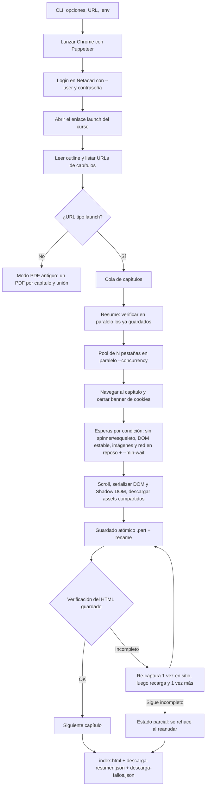

# ccna-dl — Documentación completa

> Descargador de cursos de [Cisco Networking Academy (Netacad)](https://www.netacad.com/) a **HTML sin conexión**, con descarga en paralelo, esperas por condición y validación offline.
> Rama de trabajo: `optimizacion` · Versión del paquete: `1.4.0` · Basado en [garzj/ccna-dl](https://github.com/garzj/ccna-dl).

## Índice

1. [Qué es y para qué sirve](#1-qué-es-y-para-qué-sirve)
2. [Requisitos e instalación](#2-requisitos-e-instalación)
3. [Configuración (`.env`)](#3-configuración-env)
4. [Cómo obtener el enlace del curso](#4-cómo-obtener-el-enlace-del-curso)
5. [Uso paso a paso](#5-uso-paso-a-paso)
6. [Estructura de la carpeta de salida](#6-estructura-de-la-carpeta-de-salida)
7. [Cómo funciona por dentro](#7-cómo-funciona-por-dentro)
8. [Validación](#8-validación)
9. [Pruebas](#9-pruebas)
10. [Resultados: prueba real y benchmark](#10-resultados-prueba-real-y-benchmark)
11. [Solución de problemas](#11-solución-de-problemas)
12. [Limitaciones conocidas y riesgos](#12-limitaciones-conocidas-y-riesgos)
13. [Estado de las descargas existentes y changelog](#13-estado-de-las-descargas-existentes-y-changelog)

---

## 1. Qué es y para qué sirve

`ccna-dl` abre Netacad con un navegador automatizado (Puppeteer + Chrome), inicia sesión con **tu propia cuenta**, recorre el índice (outline) de un curso y guarda **cada capítulo como un archivo HTML autónomo** junto con sus recursos (CSS, fuentes, imágenes, archivos). El resultado se puede abrir sin internet.

- **Uso previsto:** personal y educativo, con tu propia cuenta de Netacad y para cursos en los que estás matriculado. No lo uses para redistribuir material (ver el *Disclaimer* del [README](README.md)).
- Los cursos nuevos de Netacad ("launch") se guardan como **HTML offline**. Si la URL no es de tipo launch, el programa usa el modo antiguo: **PDF** por capítulo, unidos en un único PDF.
- Lo que **no** garantiza: los vídeos (ver [§12](#12-limitaciones-conocidas-y-riesgos)).

## 2. Requisitos e instalación

| Requisito | Detalle |
|---|---|
| Node.js | Se ha usado Node 22 en el PC y Node 20 en las pruebas; el validador necesita Node ≥ 16. |
| Google Chrome | Puppeteer 22 usa su propio Chrome (carpeta de caché de Puppeteer, `~/.cache/puppeteer`). Si prefieres un Chrome ya instalado, ver nota. |
| Cuenta de Netacad | Con acceso al curso. |

**Instalación (PowerShell, desde la carpeta del proyecto):**

```powershell
cd C:\Users\alexs\OneDrive\Documentos\Learn\Node\ccna-dl
npm install
npm run build        # compila src/ → lib/ (rimraf lib/ && tsc)
node lib/cli.js --help
```

> **Nota sobre Chrome / `CHROME_PATH`.** El programa (`src/cli.ts`) **no lee** `CHROME_PATH`: lanza el Chrome que descarga Puppeteer. Si quisieras usar otro Chrome, la variable que entiende Puppeteer es `PUPPETEER_EXECUTABLE_PATH`.
> `CHROME_PATH` (o `PUPPETEER_EXECUTABLE_PATH`) sí lo leen las **pruebas** y el benchmark (`test/*.js`):
> ```powershell
> $env:CHROME_PATH = 'C:\Program Files\Google\Chrome\Application\chrome.exe'
> npm test
> ```

También se puede ejecutar con `npx ccna-dl …` o `npm start -- <args>` (equivale a `node ./lib/cli.js`). Tras cambiar código en `src/` hay que repetir `npm run build`.

## 3. Configuración (`.env`)

El programa carga un archivo `.env` de la carpeta desde donde se ejecuta (`dotenv`). **Nunca subas ese archivo a git** (ya está en `.gitignore`) ni lo compartas.

Variables que el código lee (solo nombres, **sin valores**):

| Variable | Para qué sirve |
|---|---|
| `PASSWORD` | Contraseña de Netacad. Si no existe ni se pasa `--password`, el programa te la pregunta por consola (entrada oculta). |
| `NODE_ENV` | Opcional. Si no está definida se usa `production`. |

El correo/usuario **no** va en el `.env`: se pasa siempre con `--user` / `-u`.

Orden para la contraseña: `--password` → variable `PASSWORD` (`.env`) → pregunta interactiva.
Recomendación: usa `.env` o la pregunta interactiva; evita `--password` porque queda en el historial de PowerShell.

## 4. Cómo obtener el enlace del curso

El programa necesita el **enlace "launch" del contenido del curso**, no la URL de la barra de direcciones. Tiene esta forma:

```
https://www.netacad.com/es/launch?id=<id-del-curso>&tab=curriculum&view=<id-de-vista>
```

Pasos (según el [README](README.md)):

1. Entra en [netacad.com](https://www.netacad.com) e inicia sesión.
2. Abre tu curso (la opción de lanzar/abrir el curso).
3. Copia **el enlace que lleva al contenido del curso** (clic derecho sobre el botón/enlace → *Copiar dirección del enlace*), no el de la barra de direcciones. Hay una imagen de ejemplo en [`img/copy-link-example.png`](img/copy-link-example.png).
4. Pégalo **entre comillas** en PowerShell (la URL lleva `&`):

```powershell
node lib/cli.js --user tu@correo.com "https://www.netacad.com/es/launch?id=<id>&tab=curriculum&view=<id>"
```

El `id=` de la URL se usa como identificador del curso para nombrar la carpeta de salida. Se pueden pasar **varias URLs** a la vez (se procesan una tras otra).

> El contenido real se pinta dentro de un iframe de `www.netacad.com/authoring-resources/…`; el programa lo localiza solo. Pásale siempre el enlace launch, no la dirección del iframe.

## 5. Uso paso a paso

Sintaxis: `node lib/cli.js [opciones] <url> [<url2> …]` (todos los ejemplos usan PowerShell; sustituye `$URL` por tu enlace).

```powershell
$URL = "https://www.netacad.com/es/launch?id=<id>&tab=curriculum&view=<id>"
```

### 5.1 Tabla de opciones (extraída de `src/cli.ts`)

| Opción | Por defecto | Qué hace |
|---|---|---|
| `<urls…>` | — | URL(s) de los cursos (obligatoria al menos una, salvo con `--validate`). |
| `--user`, `-u` | — | Correo/usuario de Netacad (obligatorio salvo con `--validate`). |
| `--password`, `-p` | `.env` → pregunta | Contraseña. |
| `--concurrency`, `-c N` | HTML: **2** automático (baja a 1 con poca RAM libre; máx. **6**); PDF: 10 | Capítulos descargados a la vez (pestañas del navegador en paralelo). Cada pestaña puede usar ~1 GB; con un valor explícito se respeta pero se avisa si no cabe en la RAM libre. |
| `--recycle-every N` | **8** (`0` = nunca) | Cada `N` capítulos se vacía y se cierra/reabre la pestaña de cada worker para liberar la memoria del renderer de Chrome. También se recicla antes si el heap de JS de la pestaña supera ~600 MB o la RAM libre baja de ~700 MB. La pestaña de la sesión no se cierra: se cambia de proceso (`chrome://version` → `about:blank`). |
| `--no-block-media` | bloqueo activo | Por defecto el navegador **no carga** vídeo/audio (`.mp4`, `.webm`, `.mp3`, `.m4a`, `.ogv`, `.m3u8`): ocupa memoria y no es necesario, los archivos los baja Node aparte. Con esta opción se cargan como antes. |
| `--out-dir`, `-o` | `.` (carpeta actual) | Carpeta donde se crea la carpeta del curso. |
| `--only <cap>` | — | Solo ese capítulo (p. ej. `1.0`). Pensado para depurar/probar. |
| `--force` | desactivado | Vuelve a descargar todo aunque ya esté guardado y verificado. |
| `--retry-failed` | desactivado | Descarga solo los capítulos de `descarga-fallos.json`. |
| `--min-wait ms` | **1500** (500 con `--fast`) | Tiempo mínimo que el contenido debe llevar cargado antes de guardar, *además* de las esperas por condición. |
| `--chapter-timeout s` | **300** | Segundos máximos por intento de capítulo; al agotarse se reinicia esa pestaña y se reintenta. |
| `--fast` | desactivado | Modo rápido (opt-in, menos seguro): esperas más cortas y bloquea también `adobedtm` (el vídeo/audio ya se bloquea por defecto; ver `--no-block-media`). |
| `--no-block-trackers` | bloqueo activo | No bloquear analítica/publicidad/seguimiento. |
| `--asset-concurrency N` | **6** | Descargas simultáneas de recursos por capítulo. |
| `--retries N` | **3** | Reintentos con espera creciente (recursos y capítulos fallidos; los reintentos de capítulo se limitan a 2 extra). |
| `--screenshot` | desactivado | Guarda `course.png` (captura de depuración de la vista del curso). |
| `--headful` | desactivado | Abre Chrome con ventana visible (headless por defecto). |
| `--validate` | desactivado | Valida **offline** las descargas de `--out-dir` y escribe `validation-report.md`. No descarga ni inicia sesión. |
| `--format <fmt>` | `a4` | Solo modo PDF: formato de página de Puppeteer. |
| `--timeout`, `-t` | — | Solo modo PDF: tiempo máximo; al superarse se corta la descarga (se pasa a Puppeteer al generar el PDF). |
| `--help`, `-h` | — | Ayuda. |

### 5.2 Ejemplos

**Curso completo (recomendado; 2 pestañas, el valor por defecto):**

```powershell
node lib/cli.js --user tu@correo.com --concurrency 2 $URL
```

**Guardar en otra carpeta:**

```powershell
node lib/cli.js -u tu@correo.com -o D:\NetacadCursos $URL
```

**Probar un solo capítulo en una carpeta aparte (no toca tus cursos):**

```powershell
node lib/cli.js -u tu@correo.com --only 1.0 --concurrency 1 --out-dir C:\Users\alexs\ccna-test-1.0 $URL
```

**Reanudar después de un corte o Ctrl+C:** vuelve a lanzar **exactamente el mismo comando**. Los capítulos ya guardados y verificados se omiten (verificación en paralelo); se rehacen los que falten, estén dañados, estén marcados como incompletos o tengan un formato antiguo.

```powershell
node lib/cli.js -u tu@correo.com --concurrency 3 $URL
```

**Rehacer todo desde cero:**

```powershell
node lib/cli.js -u tu@correo.com --force $URL
```

**Reintentar solo lo que falló en la última ejecución** (lee `descarga-fallos.json`):

```powershell
node lib/cli.js -u tu@correo.com --retry-failed $URL
```

**Ajustar las esperas** (conexión lenta → más seguro; Netacad rápido y probado → más rápido):

```powershell
node lib/cli.js -u tu@correo.com --min-wait 2500 --chapter-timeout 420 $URL   # conservador
node lib/cli.js -u tu@correo.com --fast --concurrency 3 $URL                  # opt-in, menos seguro
```

**Ver el navegador / depurar:**

```powershell
node lib/cli.js -u tu@correo.com --headful --screenshot --only 1.0 -o C:\Users\alexs\ccna-test-1.0 $URL
```

**Otras opciones:**

```powershell
node lib/cli.js -u tu@correo.com --no-block-trackers $URL                     # no bloquear analítica
node lib/cli.js -u tu@correo.com --asset-concurrency 4 --retries 5 $URL       # recursos más suaves / más reintentos
```

**Modo PDF (solo si la URL no es del tipo launch):** genera un PDF por capítulo y los une en `<id>_<título>.pdf` dentro de `--out-dir`. Usa `--format` (p. ej. `a4`), `--timeout` y `--concurrency` (por defecto 10 en este modo).

```powershell
node lib/cli.js -u tu@correo.com --format a4 --concurrency 5 "<url-de-curso-antiguo>"
```

### 5.3 Qué verás en consola

- Mensajes de login, título del curso y número de capítulos encontrados.
- Una **barra de progreso** (cli-progress) y una línea por capítulo con su resultado y tiempo, por ejemplo `[1/1] 1.0 · ✔ guardado con avisos (49 recursos, 18s)`.
- Al final, un **resumen**: capítulos guardados / omitidos / parciales / fallidos, duración total y, con paralelismo, la ganancia estimada (`ganancia ×N`).

### 5.4 Ctrl+C

- **Primera vez:** no se empiezan capítulos nuevos; los que están en curso terminan de escribirse (escritura atómica `.part` + `rename`), se guardan el índice y el resumen y se sale con código 130.
- **Segunda vez:** sale inmediatamente.
- Para continuar, repite el mismo comando.

## 6. Estructura de la carpeta de salida

Dentro de `--out-dir` se crea una carpeta por curso, llamada `<id-del-curso>_<título saneado>`:

```
<out-dir>/
└── <id>_<Título del curso>/
    ├── index.html                 # índice con enlaces a los capítulos
    ├── chapters/
    │   ├── 1.0.html               # un HTML autónomo por capítulo
    │   ├── 1.1.html
    │   └── …
    ├── assets/
    │   ├── css/                   # hojas de estilo
    │   ├── fonts/                 # fuentes
    │   ├── img/                   # imágenes
    │   └── files/                 # otros archivos (PDF, ZIP, …)
    ├── descarga-resumen.json      # resultado de la última ejecución
    └── descarga-fallos.json       # capítulos pendientes de reintentar
```

- Los recursos se guardan una sola vez y se referencian desde los capítulos como `../assets/<categoría>/<hash>_<nombre>`.
- `descarga-resumen.json`: `courseId`, `courseTitle`, `courseUrl`, `startedAt`, `finishedAt`, `durationMs`, `totals` (`total`, `guardado`, `omitido`, `parcial`, `fallido`) y, por capítulo en `chapters`, `status`, `reason` (motivo/aviso), `assets`, `assetsFailed`, `failedAssets`, `attempts` y `ms`.
- `descarga-fallos.json`: objeto con `courseId`, `courseTitle`, `courseUrl`, `updatedAt` y la lista `failures` (cada entrada: `chapter`, `url`, `reason`, `status` = `parcial`/`fallido`, `failedAssets`, `at`). Si no hay pendientes, `failures` queda vacía (`[]`). Es el archivo que lee `--retry-failed`; un capítulo que luego sale bien se quita de la lista.
- `validation-report.md` (y opcionalmente un JSON) lo genera el [validador](#8-validación) en la carpeta analizada.
- Git ignora (ver `.gitignore`): las carpetas de cursos con prefijo hexadecimal de 8 caracteres (`<8 hex>-…`), `.env`, `lib/`, `node_modules/`, `data/`, `validation-report.md`, `validation.json` y `downloads-failures.json` de la raíz del proyecto.

## 7. Cómo funciona por dentro

### 7.1 Idea clave: paralelismo con pestañas

Node.js ejecuta tu código en **un solo hilo**, pero casi todo el tiempo de la descarga se pierde **esperando al sitio** (cargas, efectos de 1–2 s, red). Por eso el paralelismo se hace con **varias pestañas del mismo navegador y la misma sesión**, no con hilos (`worker_threads` no hacen falta).

### 7.2 Diagrama del flujo



### 7.3 Detalles importantes

- **Esperas por condición + mínimo.** Netacad muestra efectos de carga de 1–2 s y guardar antes estropea la captura. Por eso cada página espera a que (a) no queden loaders/esqueletos/spinners (también dentro de Shadow DOM), (b) las imágenes estén cargadas, (c) la red esté en reposo y (d) el DOM esté quieto (MutationObserver), **y además** respeta un mínimo (`--min-wait`). Valores por política:

  | | `minWaitMs` | DOM estable | máx. estable | URL estable | red inactiva |
  |---|---:|---:|---:|---:|---:|
  | Segura (defecto) | 1500 | 400 | 8000 | 1500 | 600 |
  | `--fast` | 500 | 250 | 5000 | 600 | 300 |

- **Verificación posterior y re-captura.** Tras guardar se comprueba el HTML (tamaño, texto, loaders, referencias locales). Si detecta una carga sin terminar, se re-captura **una vez en el sitio con más paciencia**; si no basta, se **recarga la página y se captura otra vez**; si aun así falla, el capítulo queda `parcial` (con la marca `ccna-dl-incomplete`) y se rehace al reanudar.
- **Caché de assets compartida.** Un mismo recurso (CSS, fuente, imagen) se descarga **una sola vez** aunque lo pidan varios capítulos o pestañas a la vez; hay además un límite global de descargas simultáneas y una caché de cookies de 30 s.
- **Bloqueo de trackers y medios.** Por defecto se bloquean analítica/publicidad/seguimiento y vídeo/audio a nivel de red (CDP `Network.setBlockedURLs`). No se bloquea CSS, fuentes, imágenes ni scripts del propio sitio. `--no-block-trackers` y `--no-block-media` desactivan cada bloqueo; `--fast` bloquea además `adobedtm`. Los archivos de vídeo/audio que el HTML referencie los descarga Node (no el navegador).
- **Memoria (Chrome).** (1) Reciclado de pestañas cada `--recycle-every` capítulos (o antes por heap de JS/poca RAM; se mide con `page.metrics()`): se pasa por `about:blank`, se cierra y se abre una pestaña nueva. (2) Sin vídeo/audio en el navegador. (3) Flags de Chrome (`src/browser-args.ts`): sin BackForwardCache (guardaba páginas anteriores en RAM), caché de disco/medios mínima (los recursos los baja Node; la caché de Chrome solo ocupaba disco en `%TEMP%`), sin extensiones/sync/redes de fondo, `--disable-dev-shm-usage`, `--disable-gpu` (solo headless), `--mute-audio` y tope de heap de JS `--max-old-space-size=1536`. No se usa `--renderer-process-limit` (compartir procesos entre pestañas empeora el aislamiento y las fugas). (4) Pestañas por defecto: 2, o menos si `RAM libre − 1,5 GB` no da para ~1,2 GB por pestaña; con `--concurrency` explícito se avisa si no cabe. (5) Los recursos nunca pasan por la memoria de Node: se escriben a disco en streaming (`.part` → rename), se omiten los que ya existen y los comunes se descargan una sola vez.
- **Pestañas en segundo plano.** Se emula foco por CDP y se lanzan los flags de Chrome `--disable-background-timer-throttling`, `--disable-backgrounding-occluded-windows` y `--disable-renderer-backgrounding`; si no, las pestañas ocultas pueden bloquearse (`requestAnimationFrame`).
- **Robustez.** Timeout por capítulo, reinicio de la pestaña si se cuelga/cae, reintentos con espera creciente, y una pestaña extra que recibe "Sesión no válida" antes de terminar ningún capítulo se retira (su capítulo se reencola en la pestaña principal).
- **Salida determinista.** El índice y el resumen se generan al final en el orden del outline, independientemente de qué pestaña terminó antes.
- **Pestañas/acordeones del curso.** En modo HTML, el contenido de las pestañas se serializa en paneles (`data-ccna-tab`) para que las pestañas funcionen sin red; el Shadow DOM se guarda con Declarative Shadow DOM y los estilos adoptados se incluyen.

### 7.4 Módulos de `src/`

| Archivo | Qué hace |
|---|---|
| `cli.ts` | Punto de entrada (cmd-ts): opciones, login, descubrimiento, elección HTML/PDF, Ctrl+C, bloqueo de recursos, `--validate`. |
| `login.ts` | Inicio de sesión: escribe el usuario, avanza, introduce la contraseña y gestiona el banner de cookies y la página de privacidad de Cisco. |
| `get-chapters.ts` | Lee el outline del curso y devuelve las URLs de capítulo (soporta `--only`). |
| `save-course.ts` | Orquesta el guardado: reanudar, cola, pool de pestañas, timeouts, reintentos, abortar, índice y resumen. |
| `save-chapter-html.ts` | Captura y serializa un capítulo (DOM, Shadow DOM, pestañas), reescribe assets, escribe el HTML atómicamente, construye `index.html`. |
| `wait-for-chapter-content.ts` | Navegación al capítulo, esperas de contenido, scroll y utilidades de la vista "launch". |
| `wait-policy.ts` | Políticas de espera segura / `--fast` y `--min-wait`. |
| `content-probe.ts` | Sondeo del contenido: loaders, vacíos, imágenes pendientes, estabilidad del DOM. |
| `wait-for-spinners.ts` | Espera a que desaparezcan los `.loading-spinner` (máx. 10 s). |
| `download-assets.ts` | Descarga de recursos con reintentos, deduplicación, semáforo global y caché de cookies. |
| `block-resources.ts` | Patrones de bloqueo de trackers, de medios (vídeo/audio) y modo agresivo (`--fast`). |
| `browser-args.ts` | Flags de Chrome para ahorrar memoria y disco. |
| `memory.ts` | Reciclado (heap por `page.metrics()`, RAM libre) y plan de pestañas según la RAM libre. |
| `verify-chapter.ts` | Verificación de un capítulo guardado (formato, texto, loaders, referencias locales, marca de incompleto). |
| `run-summary.ts` | Lectura/escritura de `descarga-resumen.json` y `descarga-fallos.json`. |
| `progress.ts` | Barra de progreso (cli-progress) con líneas por capítulo. |
| `url-to-chapter-id.ts` | Obtiene el número de capítulo de una URL (parámetro `_chapter` o patrón `N.N`). |
| `expand-carousels.ts`, `solve-quizzes.ts`, `click-in-bg.ts` | Solo **modo PDF** antiguo: expandir carruseles, resolver cuestionarios y hacer clic en segundo plano. |
| `config/env.ts` | Carga de `.env` (`dotenv`) y tipado de `PASSWORD` / `NODE_ENV`. |
| `util/retry.ts` | `withRetry`, `backoffMs`, `mapPool`, `waitUntil`, `fmtDuration`. |
| `util/promise.ts` | `delay`, `promisePool`, utilidades de promesas. |
| `util/object.ts` | `hasOwnProperty` (para validar el formato de página en PDF). |

También: `scripts/validate-download.js` (validador offline) y `test/` (pruebas, servidor fixture, benchmark).

## 8. Validación

El validador **no inicia sesión, no usa la red y no modifica** los cursos. Solo necesita Node ≥ 16.

```powershell
npm run validate                                   # valida todos los cursos de la carpeta del proyecto
npm run validate -- --root D:\NetacadCursos        # otra carpeta raíz
npm run validate -- --course Ciber                 # solo cursos cuyo nombre contenga "Ciber"
node lib/cli.js --validate --out-dir C:\Users\alexs\ccna-test-1.0   # equivalente desde la CLI
```

Opciones de `scripts/validate-download.js`: `--root`, `--course`, `--out <informe.md>`, `--json <informe.json>`, `--min-bytes` (30000), `--min-text` (300), `--quiet`, `--help`. Códigos de salida: `0` sin problemas graves, `1` hay graves, `2` error de uso.

**Qué revisa:**

- *Problemas graves (por capítulo):* archivo vacío; no empieza con `<!DOCTYPE html>`; HTML truncado (sin `</html>`); muy pequeño (< 30 000 bytes, `--min-bytes`) o con poco texto (< 300 caracteres, `--min-text`); parece una página de login; texto sospechoso (errores); **contenido de pestañas no guardado** (más pestañas que paneles); referencias locales rotas; recursos que siguen **remotos** (no 100 % offline); y que `index.html` enlace a todos los capítulos que hay en disco.
- *Avisos:* loaders/spinners sin ocultar, quizzes sin resolver, carruseles `mbar` por comprobar, mismo `<title>` que otro capítulo, favicon no guardado, imágenes de CSS remotas, referencias SVG `url(#id)` remotas, fuentes `ciscoSansTT` remotas, URLs absolutas dentro de datos/JSON.
- *Assets:* archivos vacíos, dañados, duplicados y sin referenciar.

**Cómo leer `validation-report.md`:**

1. **Resumen general:** una fila por curso (capítulos, con problemas, assets, tamaño, refs rotas/remotas, graves, avisos).
2. **Por curso:** estado del `index.html`, módulos detectados, capítulos en disco / sin problemas / con graves, estado de los assets y referencias comprobadas.
3. **Resumen por categoría:** tabla *Gravedad · Problema · Capítulos*. `GRAVE` = hay que actuar; `aviso` = informativo.
4. **Problemas graves** (con detalle y capítulo) y **avisos**.

> El informe antiguo de la raíz sugiere `--reindex`; **esa opción no existe**. Para regenerar el índice basta con volver a ejecutar la descarga.

Avisos normales y esperables: favicon no guardado, fuentes `ciscoSansTT` remotas (se usa una fuente de reemplazo sin internet), imágenes/recursos del CSS que ya devuelven 403/404 en el propio servidor de Netacad.

Para corregir un capítulo con problemas graves, vuelve a ejecutar el mismo comando de descarga (se rehacen los que no pasan la verificación) o usa `--only <cap> --force`.

## 9. Pruebas

```powershell
$env:CHROME_PATH = 'C:\Program Files\Google\Chrome\Application\chrome.exe'
npm test
```

`npm test` = `npm run build` + `node --test --test-timeout=600000 test/unit.test.js test/save.test.js test/parallel.test.js` (límite de 600 s por archivo; `parallel.test.js` tarda ~3 min). En un PC justo de RAM, ejecuta los tests con la descarga real parada. **No usan Netacad**: levantan un servidor local (`test/fixture-server.js`) que imita un capítulo "launch" (iframe, Shadow DOM, pestañas, esqueleto de carga, imágenes, fuentes, 404, HTML en vez de imagen, etc.).

| Archivo | Qué cubre |
|---|---|
| `test/unit.test.js` | Utilidades (backoff, reintentos, `mapPool`, `waitUntil`, `fmtDuration`), `lowercasePathVariant`, `verifyChapterHtml`, y que el validador no tome `url(%23id)` dentro de `data:` como referencia rota. |
| `test/save.test.js` | Guardado de un capítulo (assets, reintentos, pestañas), HTML funcional sin red, resumen/fallos, reanudación y `--retry-failed`. |
| `test/parallel.test.js` | Política de esperas, concurrencia (mismos archivos y mismo orden con 1 y 3 pestañas), caché de assets compartida, esqueleto de 2 s que se espera, re-captura y estado `parcial`, reanudación con paralelismo, timeout y pestaña caída, Ctrl+C, bloqueo de trackers por CDP; **memoria**: reciclado de pestañas (por contador, por heap, por poca RAM, y de la pestaña de sesión) con el mismo resultado que sin reciclar, medios bloqueados en el navegador pero descargados por Node, y `planTabs`. |
| `test/bench-mem.js`, `test/memwatch.js` | Benchmark de **memoria** (suma del RSS de Chrome y sus hijos; solo procesos propios, Linux). No es un test. |
| `test/bench.js` | Benchmark local (no es un test). |
| `test/fixture-server.js` | Servidor local con latencia simulada y efecto de carga. |

Estado actual: **30 pruebas** (11 en `unit`, 3 en `save`, 16 en `parallel`). Las 30 pasaron en la caja de pruebas (Linux) tras el cambio de memoria.

Benchmark de memoria: `node test/bench-mem.js --chapters 30 --scenarios antes:3,ahora:2` (ver [§10.4](#104-memoria-de-chrome-fixture)).

Benchmark (ejemplo): `node test/bench.js --chapters 8 --slow 1500` (con `--old <ruta a lib anterior>` compara contra una compilación previa secuencial; `--scenarios` elige modos; `--latency` fija la latencia simulada, 120 ms por defecto).

## 10. Resultados: prueba real y benchmark

### 10.1 Prueba real del capítulo 1.0 (cuenta propia, 23/10/2026)

Se descargó **solo el capítulo 1.0** del curso *CCNA: Redes Empresariales, Seguridad y Automatización* en una carpeta nueva (`C:\Users\alexs\ccna-test-1.0`), sin tocar las carpetas ya descargadas:

```powershell
node lib/cli.js --user <correo> --only 1.0 --concurrency 1 --out-dir C:\Users\alexs\ccna-test-1.0 "<URL launch>"
```

- **Login correcto** (headless, sin MFA ni captcha), página del curso cargada, título leído, URL del capítulo construida, iframe `authoring-resources` capturado.
- **Resultado:** `guardado`, 0 parciales, 0 fallidos, **18 s**, 49 recursos descargados, `descarga-fallos.json` vacío.
- `chapters/1.0.html` ≈ 1,4 MB; `assets/` con 35 archivos (≈ 27,5 MB) en `css`, `files`, `fonts` e `img`.
- **Validador:** 0 problemas graves, 0 referencias locales rotas (82 comprobadas); solo avisos esperables (14 recursos que dan 403/404 en el servidor, p. ej. fuentes `ciscoSansTT-Thin` e imágenes de fondo).
- **Contenido comprobado** abriendo el HTML sin red: títulos 1.0, 1.0.1, 1.0.2 y 1.0.3, una tabla, listas y la transcripción; 0 imágenes rotas; sin marca de incompleto; sin spinner visible.
- Durante la prueba apareció (y se corrigió, commit `9e6c6fb`) un falso positivo del validador: marcaba como "referencias rotas" los `url(%23clip…)` internos de un `data:image/svg+xml` en el CSS.
- El aviso del programa "11 contenedores de contenido vacíos" parece un falso positivo (probablemente separadores en blanco); la página renderizada offline muestra el contenido completo.

### 10.2 Benchmark en servidor local (fixture)

8 capítulos, 120 ms de latencia simulada por petición, efecto de carga (esqueleto) de 1,5 s, con las esperas **seguras** por defecto:

| Modo | Tiempo | s/capítulo | Completos | Ganancia |
|---|---:|---:|:---:|---:|
| Antes (secuencial, esperas fijas) | 51,8 s | 6,47 | 8/8 | ×1,00 |
| `--concurrency 1` | 47,5 s | 5,94 | 8/8 | ×1,09 |
| `--concurrency 3` | **18,5 s** | 2,32 | 8/8 | ×2,79 |
| `--concurrency 6` | **12,8 s** | 1,60 | 8/8 | ×4,05 |
| `--concurrency 3 --fast` | 12,3 s | 1,53 | 8/8 | ×4,22 |

Ningún modo guardó capítulos con el esqueleto de carga a medias. La ganancia viene casi toda del **paralelismo con pestañas**; la espera por capítulo apenas se acortó a propósito.

### 10.3 Qué NO está verificado

- Descubrimiento del outline **completo** de un curso real (la prueba real usó `--only 1.0`) y descarga real con `--concurrency` ≥ 2.
- Efecto del reciclado de pestañas y del bloqueo de medios en la memoria de Chrome **con Netacad real**, y que un vídeo bloqueado no deje el capítulo como «incompleto» (se ignoran los spinners `vjs-*` y está probado con el fixture, no con el reproductor real).
- Si las pestañas extra comparten bien la sesión de Netacad (no comparten `sessionStorage`; hay una salvaguarda, pero no se ha visto en vivo).
- Que los heurísticos de spinner/esqueleto/contenedor vacío coincidan con las clases reales de Netacad (son suposiciones).
- El bloqueo de trackers contra Netacad real, y el modo `--fast` en vivo.
- Comportamiento con ventana visible (`--headful`) en Windows; el efecto de pestañas en segundo plano se comprobó solo en Chrome headless.
- Tiempos reales: el benchmark es un servidor local, no Netacad.
- Capítulos con pestañas/carruseles reales: el 1.0 no tiene.

### 10.4 Memoria de Chrome (fixture)

`node test/bench-mem.js --chapters 30 --scenarios antes:3,ahora:2,ahora:3,antes:2` (Linux; suma el RSS del Chrome lanzado por la prueba y sus hijos; el RSS cuenta algo de memoria compartida, así que sirve para **comparar**, no como cifra absoluta). Cada capítulo del fixture lleva 6 imágenes de 2600×2600 px y un vídeo mp4 de 6 MB (`heavy=1`). «Antes» = flags y opciones anteriores (sin reciclado, sin bloqueo de medios); «ahora» = flags nuevos, medios bloqueados y `--recycle-every 6`.

| Escenario | Pico de RAM de Chrome | Peticiones de `.mp4` (navegador + Node) | Resultado |
|---|---:|---:|---|
| antes, 3 pestañas (el uso anterior) | 2206 MB | 60 | 30/30 guardados |
| **ahora, 2 pestañas (nuevo defecto)** | **1771 MB (−20 %)** | 30 (solo Node) | 30/30 guardados |
| ahora, 3 pestañas | 1941 MB (−12 %) | 30 (solo Node) | 30/30 guardados |
| antes, 2 pestañas | 2008 MB | 60 | 30/30 guardados |

Lecciones y límites: (a) el fixture **no reproduce** los renderers de 3 GB de Netacad (probablemente por el volumen de JavaScript, iframes y reproductores de las páginas reales), por eso la ganancia aquí es moderada; el efecto real del reciclado en un curso largo **no está medido** en vivo. (b) Se comprobó que `about:blank` por sí solo **no** libera el renderer (1190 MB → 1189 MB), que cerrar la pestaña sí (≈ −260 MB) y que ir a `chrome://version` antes (cambio de proceso) libera otros ≈125 MB en la pestaña de sesión, que no se puede cerrar; `sessionStorage` se conserva tras ese cambio. (c) Con medios bloqueados el navegador no pidió ningún `.mp4`.

## 11. Solución de problemas

| Síntoma | Qué hacer |
|---|---|
| **"Sesión no válida"** | La sesión caducó o una pestaña extra no la comparte. Baja a `--concurrency 1` o `2` y vuelve a lanzar el mismo comando (reanuda). Si persiste, prueba `--headful`. |
| **Capítulos `parcial`** | La carga no terminó ni tras re-capturar. Sube la espera (`--min-wait 2500`, `--chapter-timeout 420`) y relanza: se rehacen. También `--retry-failed`. |
| **Capturó un spinner / contenido vacío** | Usa el modo seguro (no `--fast`), sube `--min-wait` y rehace ese capítulo: `--only <cap> --force`. El validador lo avisa como "loader/spinner sin ocultar" o "texto sospechoso". |
| **403/404 de recursos del curso** | Son referencias rotas del propio curso (fuentes `ciscoSansTT`, imágenes de fondo…). Salen como avisos (`guardado con avisos`), no se reintentan y no son un fallo del programa. |
| **Muchos errores o lentitud al subir `--concurrency`** | Netacad puede limitar peticiones. Baja a 2 y no pases de 6 (el programa lo recorta). |
| **Chrome usa muchísima RAM / el PC va lento / disco casi lleno** | Cierra la descarga con Ctrl+C (una vez) y relánzala **con el mismo comando** (omite lo verificado). Usa `--concurrency 1` o `2` y, si hace falta, `--recycle-every 4`. Cierra otros programas; si el disco está al límite, libera espacio (Chrome usa una carpeta temporal en `%TEMP%`; con el cambio de memoria su caché ya está limitada a ~50 MB). Para ver el consumo: Administrador de tareas → *Google Chrome for Testing*. Un `Memoria: …` al arrancar indica que la RAM libre no alcanza para las pestañas pedidas. |
| **El PC se suspende / se corta la conexión** | Evita que el PC entre en reposo durante la descarga. Al volver, relanza el mismo comando: se omiten los capítulos verificados. Los archivos se escriben de forma atómica, así que no quedan capítulos a medias. |
| **Ctrl+C** | Una vez: termina lo que está en curso y guarda índice/resumen. Dos veces: salida inmediata. Para seguir, el mismo comando. |
| **`Falta --user`** | Añade `--user tu@correo.com`. |
| **Pide la contraseña por consola** | No hay `PASSWORD` en `.env` ni `--password`; escríbela (no se muestra) o créala en `.env`. |
| **Chrome no se encuentra** | Ejecuta `npm install` de nuevo (descarga el Chrome de Puppeteer) o define `PUPPETEER_EXECUTABLE_PATH`. Para las pruebas, `CHROME_PATH`. |
| `course.png` / `debug-*.png` sueltos | Son capturas de depuración (`--screenshot` genera `course.png`). No se versionan; puedes borrarlas. |
| **Caracteres raros en consola** | Problema de codificación de PowerShell; en el disco los nombres están bien. `[Console]::OutputEncoding=[Text.Encoding]::UTF8` ayuda. |
| **Avisos de git `LF will be replaced by CRLF`** | Inofensivos en Windows. |

Pasos generales de diagnóstico: (1) `--only <cap> --headful` para ver qué pasa; (2) revisar `descarga-resumen.json` (campo `reason` por capítulo) y `descarga-fallos.json`; (3) ejecutar el validador.

## 12. Limitaciones conocidas y riesgos

- **Rate-limit / detección.** Netacad podría limitar o bloquear muchas pestañas o peticiones simultáneas. Empieza con `--concurrency 2` (por defecto); sube con cuidado (máx. 6) y solo si tienes RAM de sobra (~1,2 GB por pestaña).
- **Vídeos.** No están verificados en una descarga real. Si el HTML trae una URL directa de archivo (`.mp4`, `.webm`…), Node la descarga y el reproductor se sustituye por un `<video>` local; si el reproductor usa *streaming* (blob/`m3u8`), el vídeo no se guarda y queda el reproductor sin contenido. El navegador no carga vídeo/audio (para ahorrar RAM; ver `--no-block-media`). Lo mismo con la transcripción interactiva y otros componentes que dependan de servicios externos.
- **Selectores de login y de la interfaz.** Dependen del HTML actual de Netacad (por ejemplo `#netacad-login-button`, `input[name="username"]`, `input[name="login"]`, clases del outline). Si Netacad cambia su web, pueden romperse y habrá que adaptar `login.ts` / `get-chapters.ts`. El propio README original avisa de que la herramienta puede quedar desfasada.
- **Enlaces remotos (`.pka`, `.pdf`, descargas de laboratorio).** Los enlaces a archivos externos (Packet Tracer `.pka`/`.pkt`, PDFs enlazados, `netacad.com/resources/lab-downloads`…) se conservan como **enlaces normales**: sin internet no abren. Solo se guardan los recursos que el capítulo carga directamente.
- **Recursos que ya fallan en el servidor** (403/404) quedan como referencia remota en el CSS.
- **Contraseña.** Se lee del `.env` o se pregunta; no la dejes en el historial de comandos.
- **Uso responsable.** Solo con tu cuenta y para estudio personal; respeta los términos de Netacad.
- **Lo no verificado** en vivo está resumido en [§10.3](#103-qué-no-está-verificado).

## 13. Estado de las descargas existentes y changelog

### 13.1 Descargas existentes en la carpeta del proyecto

Hay 4 carpetas de cursos descargadas con **versiones anteriores** (antes de las optimizaciones), ignoradas por git. Según el último informe de validación del proyecto (`validation-report.md`, 22/10/2026 23:30 hora de Lima):

| Carpeta (curso) | Capítulos | Sin problemas | Con problemas graves | Tamaño | Hallazgos principales |
|---|---:|---:|---:|---:|---|
| `586534f2-…_ENRUTAMIENTO Y CONMUTACION DE REDES` | 94 | 38 | 56 | 555,8 MB | Recursos aún remotos (41 cap.), contenido de pestañas no guardado (31), 1 con texto sospechoso, y un `index.html` que solo enlazaba 1 de los 94 capítulos. |
| `586534f2-…_ENRUTAMIENTO Y CONMUTACION DE REDES_` (con `_` final) | 26 | 19 | 7 | 314,2 MB | Pestañas no guardadas (5), recursos remotos (2). |
| `6303b08b-…_Fundamentos de Ciberseguridad` | 155 | 121 | 34 | 413,0 MB | Pestañas no guardadas (31), recursos remotos (3). |
| `cbc67ea8-…_CCNA Redes Empresariales, Seguridad y Automatización` | 52 | 24 | 28 | 172,4 MB | Sin `index.html`; recursos remotos (20), pestañas no guardadas (15), 1 con texto sospechoso. |

Avisos comunes a todos (esperables): favicon no guardado, fuentes `ciscoSansTT` remotas, imágenes de CSS que ya dan 403/404 en el servidor.

> Ese informe es **anterior** a las correcciones de las últimas versiones. Los capítulos descargados con el formato antiguo no llevan la marca `ccna-dl-format` actual, así que **al relanzar el mismo comando sin `--force` se volverán a descargar** (los marcados como "formato antiguo" o con problemas) y los que ya pasen la verificación se omitirán. Después, valida otra vez con `npm run validate`.

### 13.2 Changelog de la rama `optimizacion`

| Commit | Descripción |
|---|---|
| `80e7e06` | wip: cambios locales (punto de partida de la rama). |
| `addb0d9` | chore: ignorar cursos descargados. |
| `95c1a44` | feat: validador offline de descargas (`scripts/validate-download.js`, `npm run validate`). |
| `6744f0a` | feat: descarga robusta: reanudar, reintentos con backoff, concurrencia acotada, verificación por capítulo, pestañas, fuentes y resumen/fallos JSON. |
| `bc83f48` | test: pruebas con fixture local (sin login) y scripts npm `validate`/`test`. |
| `99c7f93` | feat: esperas por condición (sin spinner/esqueleto, DOM estable, imágenes y red en reposo) + `--min-wait`, re-captura automática de cargas incompletas y caché de assets compartida. |
| `06b2784` | feat: descarga en paralelo con pestañas (`--concurrency`, cola de workers, timeout por capítulo, Ctrl+C seguro, progreso con tiempos) y bloqueo de trackers. |
| `d53c283` | test: pruebas de paralelismo/esperas/re-captura, benchmark local y documentación de opciones. |
| `9e6c6fb` | fix(validador): ignorar `url(%23id)` dentro de `data:image/svg+xml` en CSS (falso positivo visto en la prueba real). |
| `11b511f` | docs: documentación completa. |
| *(este commit)* | perf(memoria): reciclado de pestañas (`--recycle-every`), medios bloqueados por defecto (`--no-block-media`), flags de Chrome de bajo consumo, pestañas por defecto 2 (automático según RAM libre) y aviso de memoria; el sondeo de carga ignora los spinners internos de `video.js`; pruebas y `test/bench-mem.js`. |

La rama principal `master` está en `2772302` (v1.4.0 original, sin estas mejoras).

---

*Documento generado a partir del código real (`src/cli.ts`, `README.md` y los módulos de `src/`). Si cambias opciones, actualiza este archivo.*
